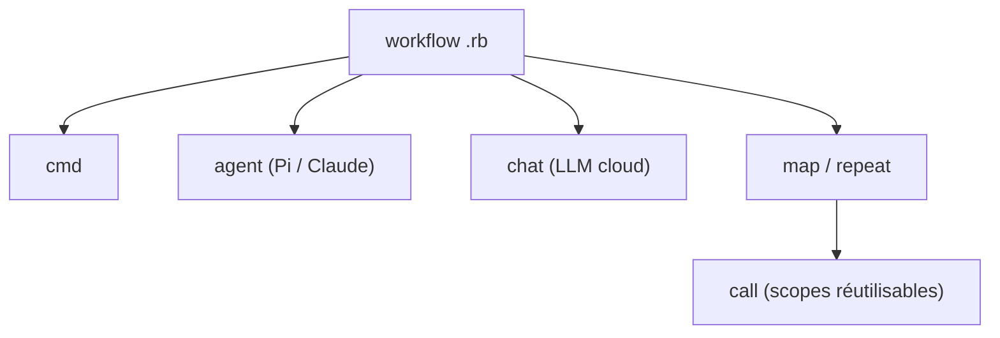

# Shopify/roast

> Ruby DSL to chain LLM steps, commands and coding agents into declarative workflows.

## The problem
AI workflows mix LLM calls, scripts and coding agents; without a framework, everything becomes an ad hoc script.

## What it actually does
A domain-specific language in Ruby where you compose "cogs": `chat` (OpenAI, Anthropic, Perplexity, Gemini, Bedrock), `agent` (Pi CLI or Claude Code CLI), `ruby`, `cmd`, `map`, `repeat`, `call`. One step's output feeds the next, with serial or parallel execution.

## How it is wired


## Trying it
```bash
gem install roast-ai
bin/roast execute analyze_codebase.rb
export ROAST_DEFAULT_CHAT_PROVIDER=anthropic
```

## Cost and gotchas
API keys per provider are at your expense; Ruby 3.0+; Pi CLI installed for the default agent. Bedrock requires temporary credentials in the environment (no AWS profiles).

## What it is not
Not a Python framework nor a hosted service. Local agents have filesystem access: to be supervised.

## Alternatives
No alternative named in the README.

## For you
Keep an eye on it: interesting for orchestrating LLM code reviews or analyses if you are comfortable with Ruby, otherwise a Python script is enough.
