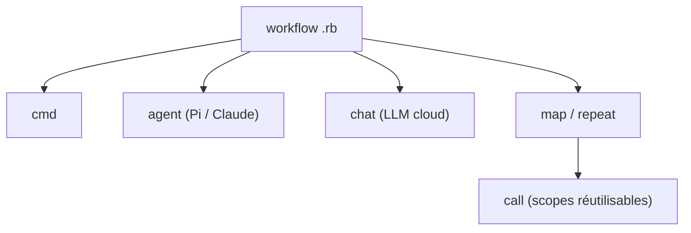

# Shopify/roast

> DSL Ruby pour enchaîner des étapes LLM, commandes et agents de code en workflows déclaratifs.

## Le problème
Les workflows IA mêlent appels LLM, scripts et agents de code ; sans cadre, tout devient un script ad hoc.

## Ce que ça fait vraiment
Un langage dédié en Ruby où l'on compose des « cogs » : `chat` (OpenAI, Anthropic, Perplexity, Gemini, Bedrock), `agent` (Pi CLI ou Claude Code CLI), `ruby`, `cmd`, `map`, `repeat`, `call`. La sortie d'une étape alimente la suivante, avec exécution en série ou en parallèle.

## Comment c'est branché


## Essayer
```bash
gem install roast-ai
bin/roast execute analyze_codebase.rb
export ROAST_DEFAULT_CHAT_PROVIDER=anthropic
```

## Coût et pièges
Clés d'API par fournisseur à ta charge ; Ruby 3.0+ ; Pi CLI installé pour l'agent par défaut. Bedrock exige des identifiants temporaires dans l'environnement (pas de profils AWS).

## Ce que ce n'est pas
Ce n'est pas un framework Python ni un service hébergé. Les agents locaux ont accès au système de fichiers : à encadrer.

## Alternatives
Aucune alternative nommée dans le README.

## Pour toi
Surveiller : intéressant pour orchestrer des revues de code ou analyses par LLM si tu es à l'aise avec Ruby, sinon un script Python suffit.

