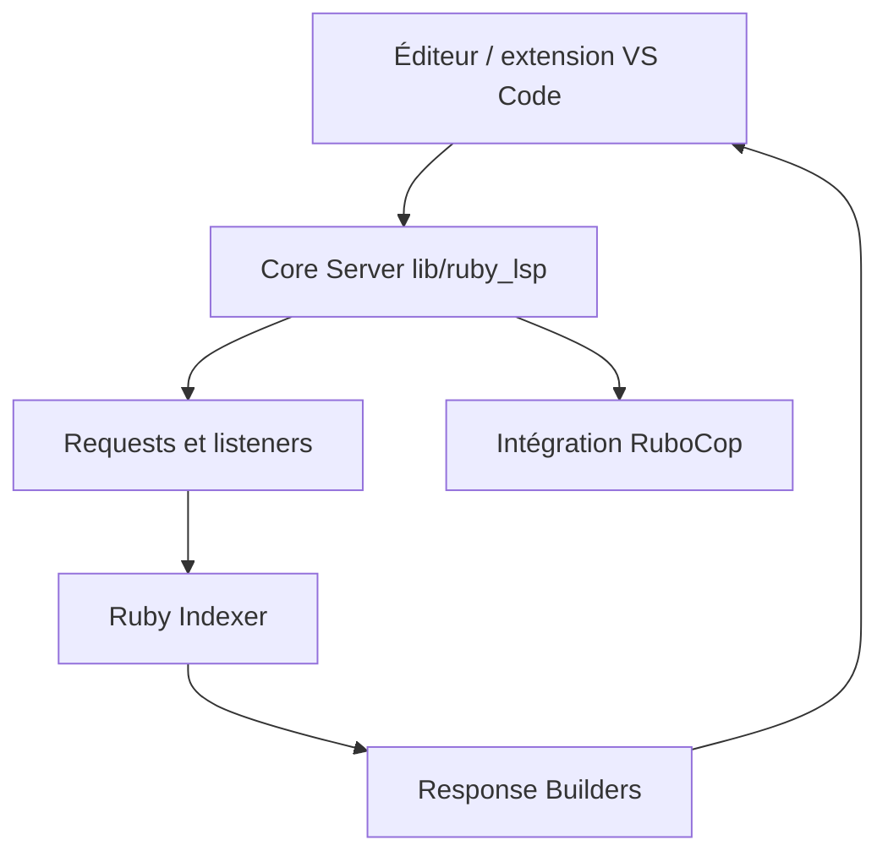

# Shopify/ruby-lsp

> LSP server for Ruby that brings completion, definitions and diagnostics to editors.

## The problem
Editors need a modern language server for Ruby (navigation, completion, formatting).

## What it actually does
Ruby gem and VS Code extension (TypeScript). Based on the architecture: the server receives LSP requests, per-feature listeners handle them, an indexer (lib/ruby_indexer, with RBS) provides the symbols, response builders return the result. RuboCop integration. Very short README.

## How it is wired


## Trying it
```bash
# Aucune commande documentée : installer l'extension Ruby LSP depuis le marketplace VS Code.
```

## Cost and gotchas
Free, but Ruby must be installed. Other editors go through the EDITORS guide.

## What it is not
Not a tool for Python or data: strictly the Ruby ecosystem.

## Alternatives
No alternative named in the README.

## For you
Ignore: without Ruby in your data/AI stack, no interest.
