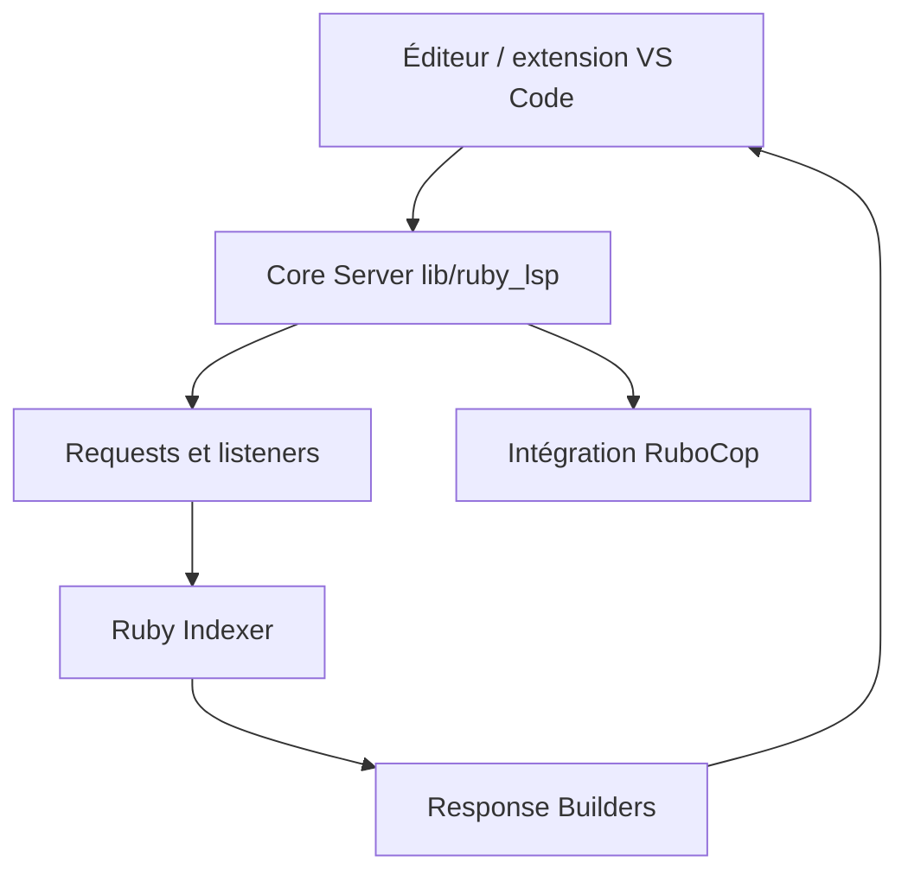

# Shopify/ruby-lsp

> Serveur LSP pour Ruby qui apporte complétion, définitions et diagnostics aux éditeurs.

## Le problème
Les éditeurs ont besoin d'un serveur de langage moderne pour Ruby (navigation, complétion, formatage).

## Ce que ça fait vraiment
Gemme Ruby et extension VS Code (TypeScript). D'après l'architecture : le serveur reçoit les requêtes LSP, des écouteurs par fonctionnalité les traitent, un indexeur (lib/ruby_indexer, avec RBS) fournit les symboles, des constructeurs de réponse renvoient le résultat. Intégration RuboCop. README très court.

## Comment c'est branché


## Essayer
```bash
# Aucune commande documentée : installer l'extension Ruby LSP depuis le marketplace VS Code.
```

## Coût et pièges
Gratuit, mais il faut Ruby installé. Les autres éditeurs passent par le guide EDITORS.

## Ce que ce n'est pas
Pas un outil pour Python ni pour la data : strictement l'écosystème Ruby.

## Alternatives
Aucune alternative nommée dans le README.

## Pour toi
Ignorer : sans Ruby dans ta stack data/IA, aucun intérêt.

