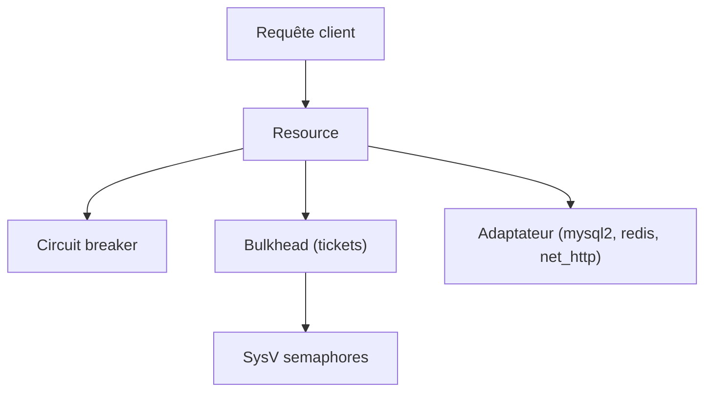

# Shopify/semian

> Circuit breaker and bulkhead for Ruby applications, to avoid cascading failures on slow resources.

## The problem
A slow database or service blocks threads waiting for the timeout and degrades all capacity, even if the error is rescued.

## What it actually does
Intercepts resource access through adapters (mysql2, redis, net_http, ActiveRecord trilogy, PostgreSQL) and immediately raises an exception if the circuit breaker is open or the bulkhead tickets are exhausted. The bulkhead uses SysV semaphores. Extracted from Shopify, in production since 2014.

## How it is wired


## Trying it
```ruby
gem 'semian', require: %w(semian semian/mysql2 semian/redis)
```
```bash
BUNDLE_GEMFILE=gemfiles/activerecord_trilogy_adapter.gemfile bundle exec rake examples:activerecord_trilogy_adapter
```

## Cost and gotchas
Free. Complex: the README itself asks you to understand the tool well before production. The bulkhead must be disabled with threads (Puma, Sidekiq); shared singleton instance: misleading behavior.

## What it is not
Not a magic solution against latency; it turns slowness into fast exceptions to handle.

## Alternatives
Hystrix and Release It are cited as sources of inspiration; Toxiproxy is used for resilience testing.

## For you
Ignore: Ruby-specific; the circuit breaker pattern remains instructive for calls to a model or an external API.
