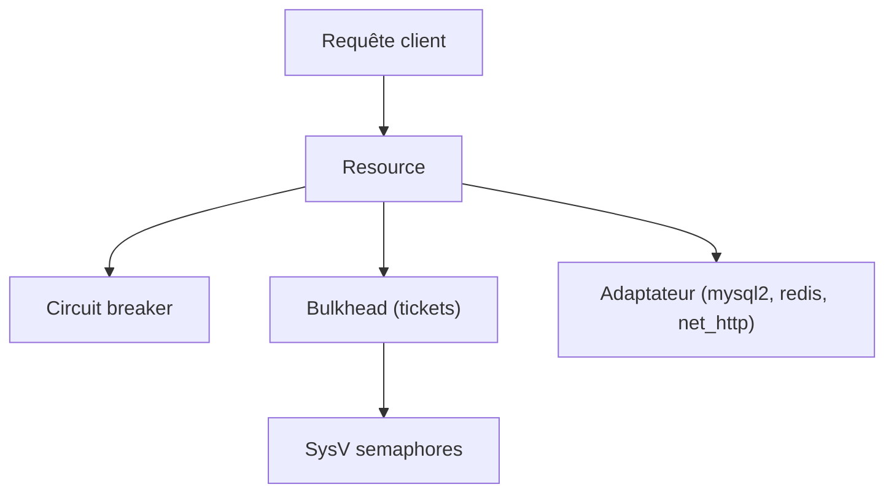

# Shopify/semian

> Disjoncteur et cloisonnement pour applications Ruby, afin d'éviter les pannes en cascade sur ressources lentes.

## Le problème
Une base ou un service lent bloque les threads en attendant le délai d'attente et dégrade toute la capacité, même si l'erreur est rattrapée.

## Ce que ça fait vraiment
Intercepte l'accès aux ressources via des adaptateurs (mysql2, redis, net_http, ActiveRecord trilogy, PostgreSQL) et lève tout de suite une exception si le disjoncteur est ouvert ou si les tickets du cloisonnement sont épuisés. Le cloisonnement utilise des sémaphores SysV. Extrait de Shopify, en production depuis 2014.

## Comment c'est branché


## Essayer
```ruby
gem 'semian', require: %w(semian semian/mysql2 semian/redis)
```
```bash
BUNDLE_GEMFILE=gemfiles/activerecord_trilogy_adapter.gemfile bundle exec rake examples:activerecord_trilogy_adapter
```

## Coût et pièges
Gratuit. Complexe : le README lui-même demande de bien comprendre l'outil avant la production. Le cloisonnement est à désactiver avec des threads (Puma, Sidekiq) ; instance partagée en singleton : comportement trompeur.

## Ce que ce n'est pas
Pas une solution magique contre la latence ; il transforme les lenteurs en exceptions rapides à gérer.

## Alternatives
Hystrix et Release It sont cités comme sources d'inspiration ; Toxiproxy sert aux tests de résilience.

## Pour toi
Ignorer : spécifique à Ruby ; le motif disjoncteur reste instructif pour des appels à un modèle ou une API externe.

