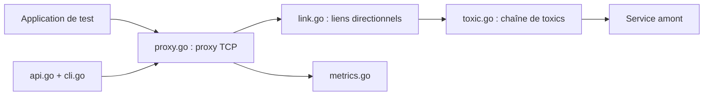

# Shopify/toxiproxy

> TCP proxy that simulates network failures to test an application's resilience in CI and in dev.

## The problem
Proving that an application survives a slow or failing database or cache requires degrading the network in a reproducible way, without root rights.

## What it actually does
A Go server listens on ports, relays to the upstream, and applies "toxics" driven by an HTTP API (port 8474): latency, down, bandwidth, slow close, timeout, reset, packet slicing, packet loss. Clients exist in several languages; a CLI and Prometheus metrics are provided.

## How it is wired


## Trying it
```bash
docker pull ghcr.io/shopify/toxiproxy
docker run --rm -it ghcr.io/shopify/toxiproxy
toxiproxy-cli create -l localhost:26379 -u localhost:6379 redis
toxiproxy-cli toxic add -t latency -a latency=1000 redis
```

## Cost and gotchas
Free. Use ports outside the Linux ephemeral range. MySQL may go through a Unix socket and bypass the proxy.

## What it is not
Only simulates TCP, not machine or disk failures. The application must be configured to go through the proxy.

## Alternatives
- No alternative named in the README (it mentions `nc` and Linux tools, not retained for portability).

## For you
To adopt: to test that an inference service or a pipeline handles a slow or cut database or feature store, it is simple and needs no root.
