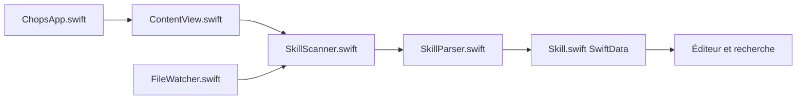

# Shpigford/chops

> A macOS application to discover, organize and edit the skills and agents of several coding tools.

## The problem
Skills and agents are scattered across the hidden folders of each tool (Claude Code, Cursor, Codex, Windsurf, Amp), and are hard to find again.

## What it actually does
SwiftUI and SwiftData, no web view. `SkillScanner` walks each tool's directories, `SkillParser` reads the YAML frontmatter or Cursor's `.mdc` files, and `FileWatcher` (FSEvents) relaunches the scan on every change. Full-text search, collections that do not modify the sources, built-in editor, skill creation, remote servers, skills.sh registry. Duplicates created through symbolic links are counted only once.

## How it is wired


## Trying it
```bash
git clone https://github.com/Shpigford/chops.git
cd chops
brew install xcodegen
xcodegen generate
open Chops.xcodeproj
```

## Cost and gotchas
macOS 15+, Xcode and xcodegen. The application deliberately disables the sandbox so it can read configuration files in `~/`. No automated tests. A binary is offered for download.

## What it is not
Not cross-platform: macOS only. Not a full skill installation manager. The agent composition assistant and the diff review were not examined in the README.

## Alternatives
No alternative named in the README.

## For you
Worth watching: useful if you accumulate skills for several agents on a Mac, but the lack of a sandbox and the unrecognized license call for vigilance.
