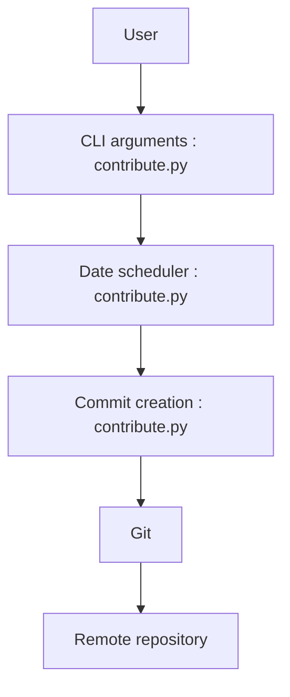

# Shpota/github-activity-generator

> Python script that fabricates dated commits to artificially fill the GitHub contribution graph.

## The problem
Getting a filled GitHub activity graph without having actually coded.

## What it actually does
`contribute.py` initializes an empty git repository, modifies a text file for each day of the past year (0 to 20 commits per day), then pushes it to a remote repository if `--repository` is given. Options: frequency, maximum per day, weekends, date range.

## How it is wired


## Trying it
```bash
python contribute.py --repository=git@github.com:user/repo.git
python contribute.py --max_commits=12 --frequency=60 --repository=git@github.com:user/repo.git
python contribute.py --no_weekends
```

## Cost and gotchas
Free. Python and Git required. The README warns: do not use it to mislead about your professional activity.

## What it is not
Not a productivity tool: it produces no real work, only a faked graph. Last push in January 2025.

## Alternatives
No alternative named in the README.

## For you
Ignore: faking your contribution graph hurts your credibility, and the tool brings nothing useful.
