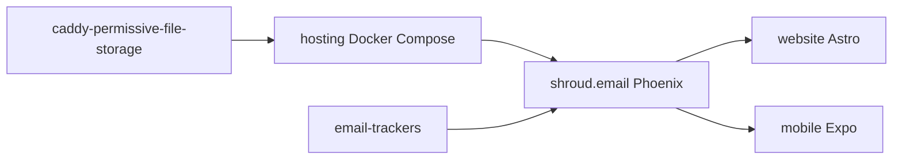

# Shroud-email/shroud.email

> Monorepo of an email alias service that strips trackers, with website, mobile and self-hosting.

## The problem
Giving your real email address to every service exposes you to trackers and spam.

## What it actually does
Creates aliases that remove trackers and forward messages to your inbox. The repo groups six projects: an Elixir/Phoenix app, an Astro site with OpenAPI docs, a React Native/Expo mobile app, a Docker Compose self-hosting stack, a tracker list, a Caddy storage module.

## How it is wired


## Trying it
```bash
mise install
mise exec -- mix test          # depuis shroud.email/
mise exec -- pnpm run build    # depuis website/
docker compose config --quiet  # depuis hosting/
```

## Cost and gotchas
Free. Tooling via mise, Elixir, Node. AGPL-3.0 license: sharing obligations if you expose a modified version. A history migration is in progress (do not overwrite commits).

## What it is not
Not an email client: an alias relay. The README commands are development checks, not an installation guide for users.

## Alternatives
No alternative named in the README.

## For you
Worth watching: an email alias service useful for privacy, but with no direct link to data or AI.
