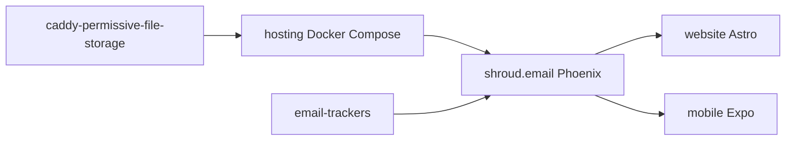

# Shroud-email/shroud.email

> Monorepo d'un service d'alias e-mail qui supprime les pisteurs, avec site, mobile et auto-hébergement.

## Le problème
Donner sa vraie adresse e-mail à chaque service l'expose aux pisteurs et au spam.

## Ce que ça fait vraiment
Crée des alias qui retirent les pisteurs et transmettent les messages vers ta boîte. Le dépôt regroupe six projets : appli Elixir/Phoenix, site Astro avec docs OpenAPI, appli mobile React Native/Expo, pile Docker Compose d'auto-hébergement, liste de pisteurs, module de stockage Caddy.

## Comment c'est branché


## Essayer
```bash
mise install
mise exec -- mix test          # depuis shroud.email/
mise exec -- pnpm run build    # depuis website/
docker compose config --quiet  # depuis hosting/
```

## Coût et pièges
Gratuit. Outillage via mise, Elixir, Node. Licence AGPL-3.0 : obligations de partage si tu exposes une version modifiée. Une migration d'historique est en cours (ne pas écraser les commits).

## Ce que ce n'est pas
Pas un client de messagerie : un relais d'alias. Les commandes du README sont des vérifications de développement, pas un guide d'installation pour utilisateur.

## Alternatives
Aucune alternative nommée dans le README.

## Pour toi
À surveiller : service d'alias e-mail utile en vie privée, mais sans lien direct avec la data ou l'IA.

