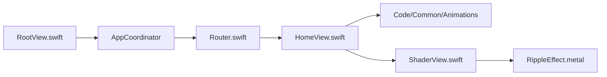

# Shubham0812/SwiftUI-Animations

> A collection of about twenty SwiftUI animations and Metal shaders to copy, for iOS developers.

## The problem
Writing polished interface animations (loaders, buttons, toggles) in SwiftUI takes time without complete examples.

## What it actually does
An iOS 17+ demo app lists 25+ animations, each in its own self-contained folder (`Code/Common/Animations/`). Two Metal shaders (Burn, Ripple) are provided with their SwiftUI wrapper. Haptic feedback goes through `HapticManager`.

## How it is wired


## Trying it
```bash
git clone https://github.com/Shubham0812/SwiftUI-Animations.git
cd SwiftUI-Animations
open SwiftUI-Animations.xcodeproj
```
Then pick a simulator and run (⌘R).

## Cost and gotchas
Free, but Xcode 16+ and iOS 17+ are required, so you need a Mac.

## What it is not
Not a library installable through a package manager: you copy the folders. No documented test coverage.

## Alternatives
No alternative named in the README.

## For you
Ignore for a data/AI/MLOps profile: it is iOS front-end work, unrelated to your data or model pipelines.
