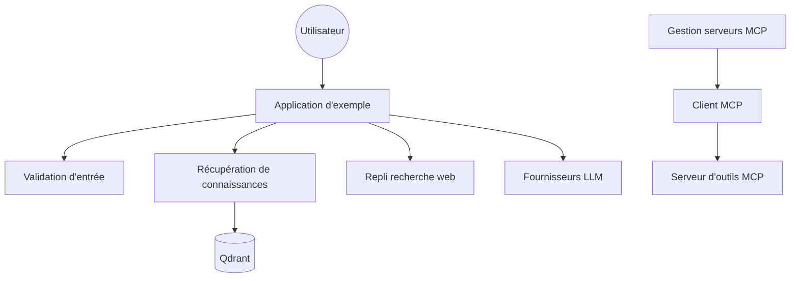

# Shubhamsaboo/awesome-llm-apps

> Catalogue of over one hundred RAG (Retrieval-Augmented Generation) agents and applications, available as executable code under the Apache-2.0 license.

## The problem
Moving from an LLM tutorial to a working application requires piecing together disparate elements.
The typical "awesome" lists usually provide links, not executable code.

## What it actually does
Comprehensive range of applications by category: beginner agents, advanced agents, multi-agent teams,
voice agents, MCP agents, RAG, memory, fine-tuning, token optimization, always-active agents.
Each entry is a standalone folder with its dependencies and, most often, a Streamlit interface.
It also includes "agent skills" that can be installed with a single command for a code agent.

## How it is wired


## Trying it
```bash
git clone https://github.com/Shubhamsaboo/awesome-llm-apps.git
cd awesome-llm-apps/starter_ai_agents/ai_travel_agent
pip install -r requirements.txt
streamlit run travel_agent.py
```

## Cost and gotchas
Apache-2.0, free. Almost every example requires a paid API key (OpenAI, Gemini, Firecrawl…).
The models mentioned in the descriptions change frequently; older versions quickly become outdated.

## What it is not
Not a library: nothing to import; these are demonstrations to copy and adapt.
Not production-ready code: no testing, no serious error handling, no security.
The quality varies from one directory to another: it's a collection, not a consistent product.

## Alternatives
- `addyosmani/agent-skills`: Focus on practical workflows rather than demonstrations.
- `langchain-ai/langchain`: if the goal is to build, rather than simply copy.

## For you
A good source of ideas and starting points; nothing should be taken as is in a serious project.
