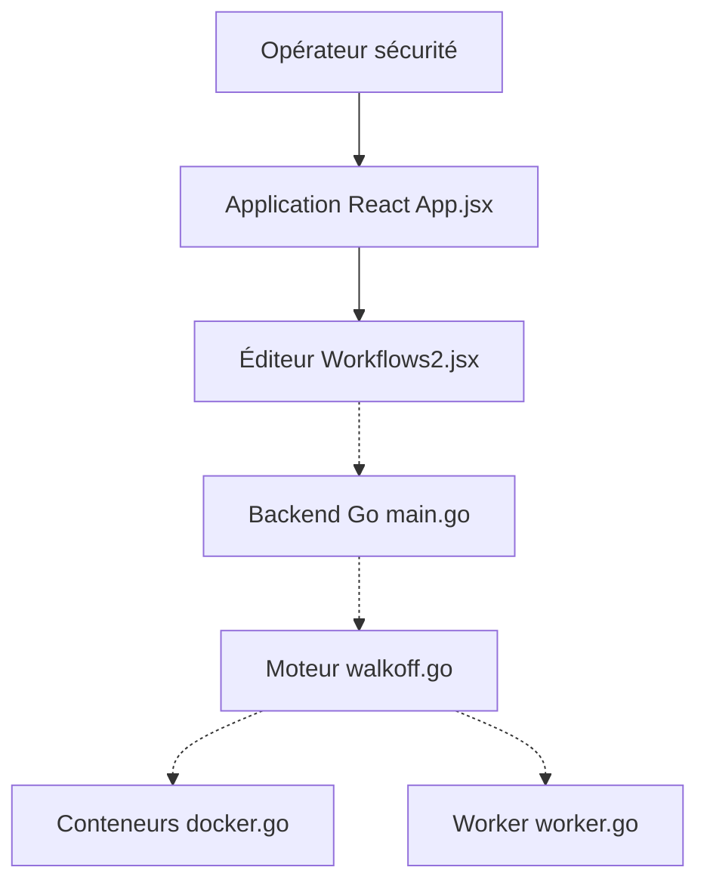

# Shuffle/Shuffle

> Open-source automation platform for security teams, with a workflow editor and ready-made apps.

## The problem
Security teams chain tools by hand (alerts, enrichment, tickets) and lack shared automation.

## What it actually does
A web workflow editor, an app builder from OpenAPI, ready-made apps for security tools and control per organization and sub-organization. The Go backend runs the workflows, with an on-premises worker. Optional hybrid sharing with the shuffler.io cloud service.

## How it is wired

## Trying it
No command in the README: it points to the self-hosted installation guide, or to signing up on shuffler.io. A `docker-compose.yml` is present for deployments.

## Cost and gotchas
The cloud requires an account; self-hosting goes through Docker. AGPL-3.0 license. 497 open issues. The README asks for sponsorship to speed up development.

## What it is not
Not an AI or data tool: it is SOAR for security. Not a simple script: it is a full platform to host.

## Alternatives
No alternative named in the README.

## For you
Keep an eye on it: relevant only if your team does operational security; outside that case, nothing for a data / AI profile.
