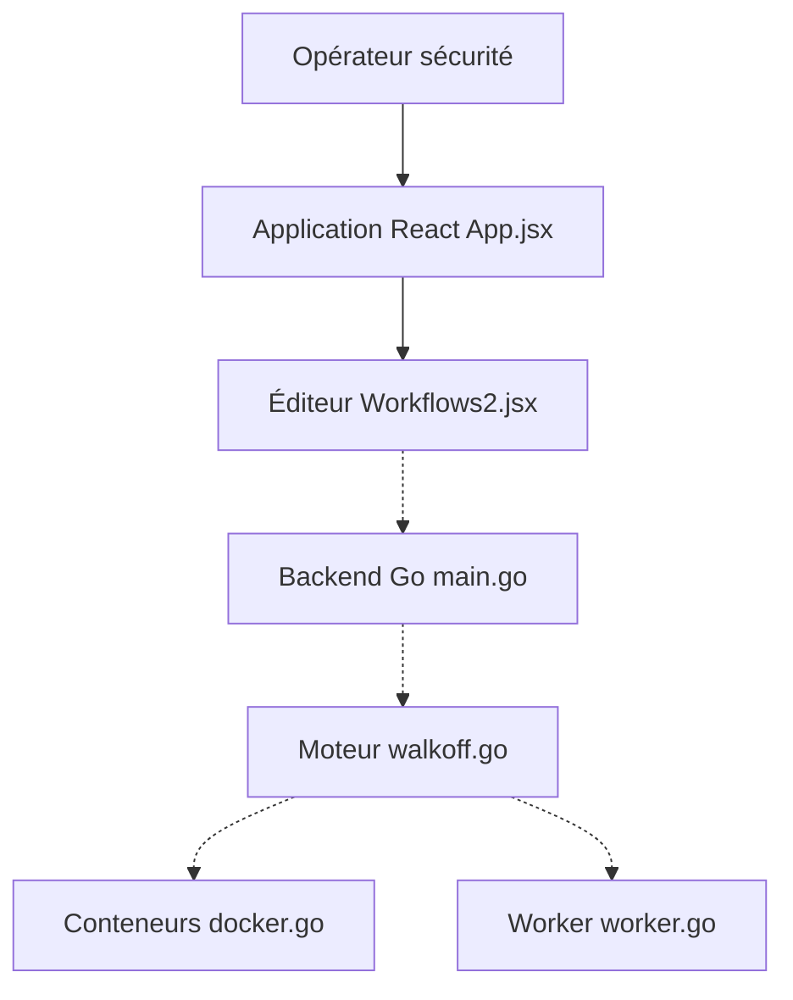

# Shuffle/Shuffle

> Plateforme open source d'automatisation pour équipes de sécurité, avec éditeur de workflows et applications prêtes à l'emploi.

## Le problème
Les équipes de sécurité enchaînent à la main des outils (alertes, enrichissement, tickets) et manquent d'automatisation partagée.

## Ce que ça fait vraiment
Un éditeur de workflows en interface web, un créateur d'apps à partir d'OpenAPI, des apps prêtes pour des outils de sécurité et un contrôle par organisation et sous-organisation. Le backend en Go exécute les workflows, avec un worker sur site. Option de partage hybride avec le service cloud shuffler.io.

## Comment c'est branché

## Essayer
Aucune commande dans le README : renvoi au guide d'installation auto-hébergée, ou inscription sur shuffler.io. Un `docker-compose.yml` est présent pour les déploiements.

## Coût et pièges
Le cloud demande un compte ; l'auto-hébergement passe par Docker. Licence AGPL-3.0. 497 issues ouvertes. Le README demande un parrainage pour accélérer le développement.

## Ce que ce n'est pas
Pas un outil d'IA ou de data : c'est du SOAR pour la sécurité. Pas un simple script : c'est une plateforme complète à héberger.

## Alternatives
Aucune alternative nommée dans le README.

## Pour toi
À surveiller : pertinent seulement si ton équipe fait de la sécurité opérationnelle ; hors de ce cas, rien pour un profil data / IA.

