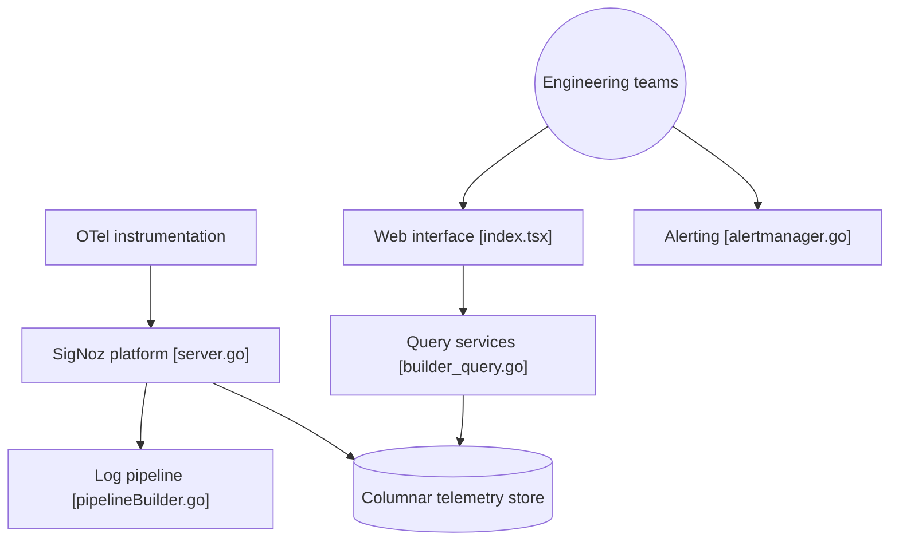

# SigNoz/signoz

> OpenTelemetry-native observability platform (logs, metrics, traces, alerts) for teams running services in production.

## The problem
Stacking Prometheus, Jaeger, Loki and dashboards separates the signals: you jump from one tool to another to diagnose an incident.

## What it actually does
Receives OpenTelemetry telemetry, stores it in a columnar database and queries it via a query builder, PromQL or ClickHouse SQL. Provides APM, logs correlated with traces, dashboards, alerts, trace funnels and LLM application monitoring. An MCP server exists; the Noz assistant is only available on the Cloud.

## How it is wired


## Trying it
Self-hosted installation advertised via Foundry, Docker, Kubernetes or Linux, with no exact command in the README provided. The Cloud offers a 30-day trial without a card.
```bash
# aucune commande documentée dans le README fourni
```

## Cost and gotchas
Cloud pay-as-you-go (from $49). Self-hosting requires operating a columnar database. Noz and the enterprise options (BYOC, advanced RBAC) are not in the community version.

## What it is not
Not a simple metrics tool. The figures comparing it with Elastic and Loki come from the authors. License not identified by GitHub: read it before commercial use.

## Alternatives
- Prometheus: sufficient if only metrics matter.
- Jaeger: traces only, lighter.
- Loki: logs only, named in the README.

## For you
Worth watching: a unified OTel observability stack is useful in MLOps, but the license to verify and the operation of the database hold back immediate adoption.
