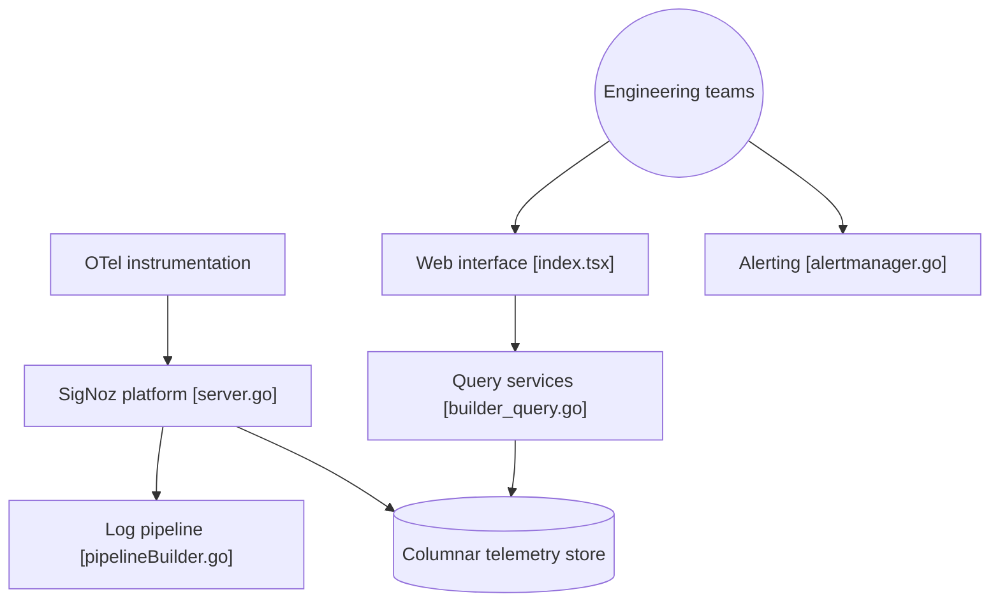

# SigNoz/signoz

> Plateforme d'observabilité native OpenTelemetry (logs, métriques, traces, alertes) pour équipes qui exploitent des services en production.

## Le problème
Superposer Prometheus, Jaeger, Loki et des dashboards sépare les signaux : on saute d'un outil à l'autre pour diagnostiquer un incident.

## Ce que ça fait vraiment
Reçoit la télémétrie OpenTelemetry, la stocke dans une base colonnaire et l'interroge via un query builder, PromQL ou ClickHouse SQL. Fournit APM, logs corrélés aux traces, dashboards, alertes, trace funnels et un suivi d'applications LLM. Un serveur MCP existe ; l'assistant Noz n'est disponible que sur le Cloud.

## Comment c'est branché


## Essayer
Installation auto-hébergée annoncée via Foundry, Docker, Kubernetes ou Linux, sans commande exacte dans le README fourni. Le Cloud propose 30 jours d'essai sans carte.
```bash
# aucune commande documentée dans le README fourni
```

## Coût et pièges
Cloud à l'usage (à partir de 49 $). L'auto-hébergement exige d'opérer une base colonnaire. Noz et les options entreprise (BYOC, RBAC avancé) ne sont pas dans la version communautaire.

## Ce que ce n'est pas
Pas un simple outil de métriques. Les comparaisons chiffrées avec Elastic et Loki viennent des auteurs. Licence non identifiée par GitHub : à lire avant usage commercial.

## Alternatives
- Prometheus : suffisant si seules les métriques comptent.
- Jaeger : traces seules, plus léger.
- Loki : logs seuls, nommé dans le README.

## Pour toi
À surveiller : une pile d'observabilité unifiée OTel est utile en MLOps, mais la licence à vérifier et l'exploitation de la base freinent une adoption immédiate.

