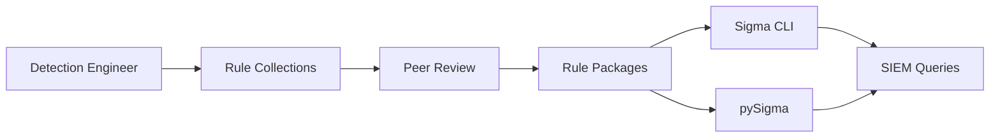

# SigmaHQ/sigma

> Repository of more than 3000 Sigma detection rules, a generic format for SIEMs.

## The problem
Analysts write their detection queries in their own SIEM's language, with no common format to share them.

## What it actually does
Provides peer-reviewed YAML rules: generic, hunting, emerging threats, compliance, placeholders.
The rules are vendor-independent and converted into SIEM queries by Sigma CLI, sigconverter.io, Detection Studio or pySigma.
Rule packages are published in releases. No implementation code in this repository.

## How it is wired

## Trying it
No command documented in the README (download the packages from the releases page).

## Cost and gotchas
Free. License not identified by GitHub: check before commercial use. Conversion goes through separate tools.

## What it is not
Not a detection engine nor a converter: just the rules. Not a SIEM.

## Alternatives
- pySigma: to integrate conversion into your own pipeline.
- Sigma CLI: official command-line converter.

## For you
Ignore: reference resource for security detection, unrelated to data science or MLOps unless you train models on SOC logs.
