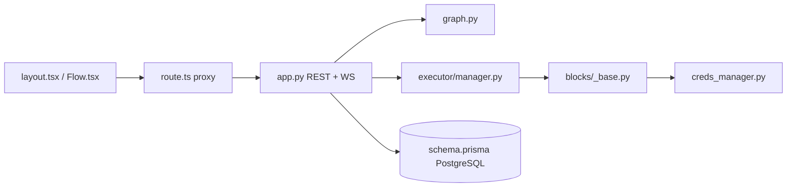

# Significant-Gravitas/AutoGPT

> Platform for AI agents in a block-based graph, offered as a paid or self-hosted service, to automate workflows.

## The problem
To chain together LLM calls, SaaS integrations, planning, and triggers, one needs to write and operate an entire agent runtime themselves.

## What it actually does
A visual editor using Next.js (`Flow.tsx`) registers an agent as a versioned graph of typed blocks (`graph.py`). A separate, asynchronous API executor (`executor/manager.py`, `scheduler.py`) launches runs on demand, on a schedule, or via webhook, while tracking status and cost.
The blocks cover LLM calls, control flows, external APIs, and nested agents; OAuth credentials are managed through `creds_manager.py`. A conversational Copilot can create and launch agents, with a Graphiti memory on FalkorDB.
Infrastructure: PostgreSQL/Supabase, Redis, RabbitMQ. The original standalone agent remains in `classic/` (MIT).

## How it is wired

## Trying it
There is no command in the README: the single-container installer is "coming soon," and it refers to the manual self-hosting guide.

## Cost and gotchas
Paid hosted platform (subscription + per-run usage). Self-hosting without a paid license, but you are responsible for providing Docker, infrastructure, and API keys.

## What it is not
This is no longer the standalone "AutoGPT" from 2023, which has now been moved to the `classic/` directory. Self-hosting doesn't yet have a public installer, and it requires a complex setup (Postgres, Redis, RabbitMQ, FalkorDB).

## Alternatives
- AutoGPT Classic (`classic/`, Forge, `agbenchmark`) — for a single, autonomous agent, or for measuring an agent.

## For you
Things to watch out for: It's interesting for orchestration, but self-hosting still requires manual and intensive effort.
