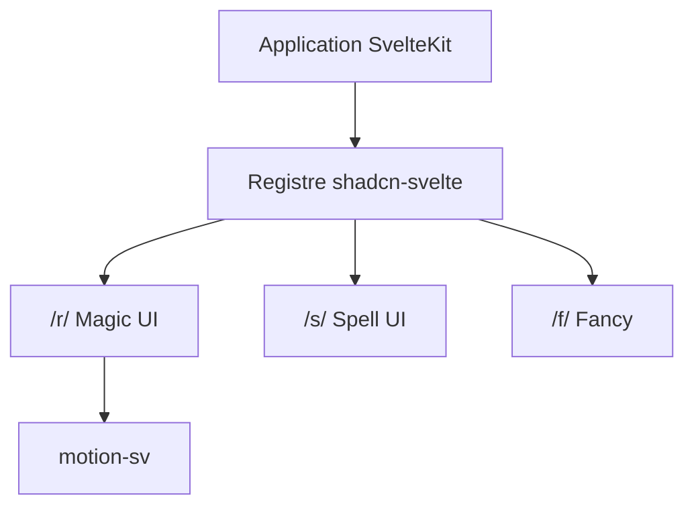

# SikandarJODD/animations

> Copy-paste animation components for Svelte 5, inspired by Magic UI, Spell UI and Fancy Components.

## The problem
Popular UI animation libraries target React, not Svelte 5.

## What it actually does
The repository ships 88 components split into three series (Magic UI: 57, Spell UI: 21, Fancy: 10). They are installed one by one through the shadcn-svelte registry and rely on motion-sv and Tailwind CSS.

## How it is wired
Simplified diagram based on the card, no diagram provided.


## Trying it
```bash
pnpm dlx sv create my-app
pnpm dlx shadcn-svelte@latest init
pnpm add motion-sv
pnpm dlx shadcn-svelte@latest add https://sv-animations.vercel.app/r/morphing-text.json
```

## Cost and gotchas
Free. Node and pnpm. The project is a personal adaptation, the Fancy series is still under construction.

## What it is not
It is not a package to import: you copy the code into your project. It is not original work, the creators are credited.

## Alternatives
Magic UI, Spell UI and Fancy Components, whose components are reused.

## For you
Ignore: Svelte UI decoration, only useful for a showcase dashboard.
