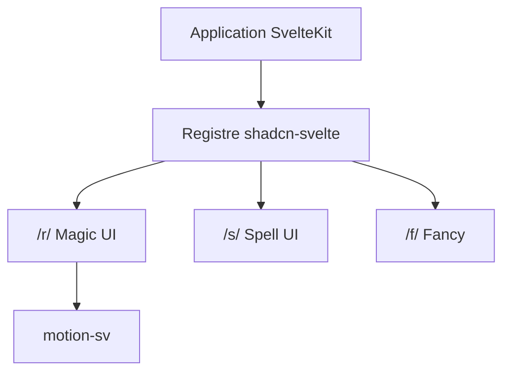

# SikandarJODD/animations

> Composants d'animation à copier-coller pour Svelte 5, inspirés de Magic UI, Spell UI et Fancy Components.

## Le problème
Les bibliothèques d'animations d'interface populaires ciblent React, pas Svelte 5.

## Ce que ça fait vraiment
Le dépôt livre 88 composants répartis en trois séries (Magic UI : 57, Spell UI : 21, Fancy : 10). Ils s'installent un par un via le registre shadcn-svelte et reposent sur motion-sv et Tailwind CSS.

## Comment c'est branché
Schéma simplifié d'après la fiche, sans diagramme fourni.


## Essayer
```bash
pnpm dlx sv create my-app
pnpm dlx shadcn-svelte@latest init
pnpm add motion-sv
pnpm dlx shadcn-svelte@latest add https://sv-animations.vercel.app/r/morphing-text.json
```

## Coût et pièges
Gratuit. Node et pnpm. Le projet est une adaptation personnelle, la série Fancy est encore en construction.

## Ce que ce n'est pas
Ce n'est pas un paquet à importer : on copie le code dans son projet. Ce n'est pas du travail original, les créateurs sont crédités.

## Alternatives
Magic UI, Spell UI et Fancy Components, dont les composants sont repris.

## Pour toi
À ignorer : décor d'interface Svelte, utile seulement pour un tableau de bord vitrine.

