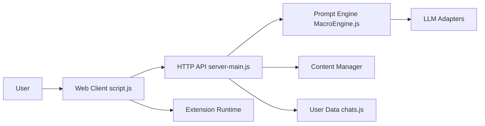

# SillyTavern/SillyTavern

> Local web interface to chat with several LLMs, aimed at advanced users.

## The problem
Not documented in the README (a single line: "LLM Frontend for Power Users").

## What it actually does
From the described architecture: a browser client (`script.js`) served by a Node HTTP server (`server.js`, `server-main.js`) that relays to LLM, image, text-to-speech and embedding providers.
Prompt macro engine, character cards, lorebooks, extensions (memory, TTS).
Local embeddings or vLLM for vector search.

## How it is wired

## Trying it
No command documented in the README.

## Cost and gotchas
LLM provider keys are at your expense (inferred from the architecture). AGPL-3.0.

## What it is not
Not a development or MLOps tool: oriented toward conversation and role-play. README insufficient to judge the rest.

## Alternatives
No alternative named in the README.

## For you
A general-public chat interface for LLMs, designed for role-play, not for professional data or MLOps use. Ignore.
