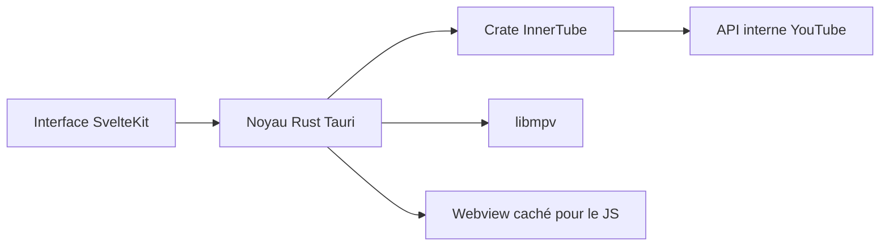

# SimoHypers/limusic

> A YouTube Music desktop client in Rust and Tauri, without Electron, that plays audio through libmpv.

## The problem
The YouTube Music web client is heavy and shows ads. A lightweight native client is missing.

## What it actually does
A Rust crate talks to YouTube's internal InnerTube API, a hidden webview runs the signature JavaScript, and libmpv plays the audio (gapless playback, normalization). The interface is a SvelteKit SPA. Synced lyrics, Last.fm and ListenBrainz scrobbling, Discord, listening rooms with a self-hosted relay.

## How it is wired
Simplified diagram based on the card, no diagram provided.



## Trying it
```bash
cd ui && pnpm install && cd ..
cargo tauri build
cargo run -p sync-server
```

## Cost and gotchas
Free, but built on YouTube's unofficial API: it can break without notice. The project is not affiliated with YouTube. The macOS binary is unsigned and there is no Intel macOS version.

## What it is not
Not an independent service: it depends entirely on YouTube Music. GPL-3.0 license. Lyrics query Boidu for every track by default.

## Alternatives
No alternative named in the README, apart from Metrolist, whose playback engine it reuses on Android.

## For you
Ignore: a music player unrelated to your work, dependent on an unofficial API.
