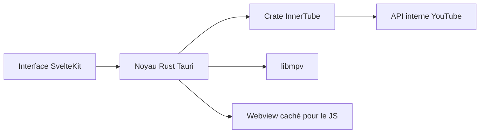

# SimoHypers/limusic

> Un client de bureau YouTube Music en Rust et Tauri, sans Electron, qui lit l'audio via libmpv.

## Le problème
Le client web de YouTube Music est lourd et affiche des pubs. Il manque un client natif léger.

## Ce que ça fait vraiment
Une crate Rust parle à l'API interne InnerTube de YouTube, un webview caché exécute le JavaScript de signature, et libmpv joue l'audio (lecture continue, normalisation). L'interface est une SPA SvelteKit. Paroles synchronisées, scrobbling Last.fm et ListenBrainz, Discord, salons d'écoute à relais auto-hébergé.

## Comment c'est branché
Schéma simplifié d'après la fiche, sans diagramme fourni.



## Essayer
```bash
cd ui && pnpm install && cd ..
cargo tauri build
cargo run -p sync-server
```

## Coût et pièges
Gratuit, mais appuyé sur l'API non officielle de YouTube : elle peut casser sans préavis. Le projet n'est pas affilié à YouTube. Le binaire macOS n'est pas signé et il n'existe pas de version macOS Intel.

## Ce que ce n'est pas
Pas un service indépendant : il dépend entièrement de YouTube Music. Licence GPL-3.0. Les paroles interrogent Boidu à chaque titre par défaut.

## Alternatives
Aucune alternative nommée dans le README, hormis Metrolist, dont il reprend le moteur de lecture sur Android.

## Pour toi
À ignorer : un lecteur de musique sans lien avec ton métier, dépendant d'une API non officielle.

