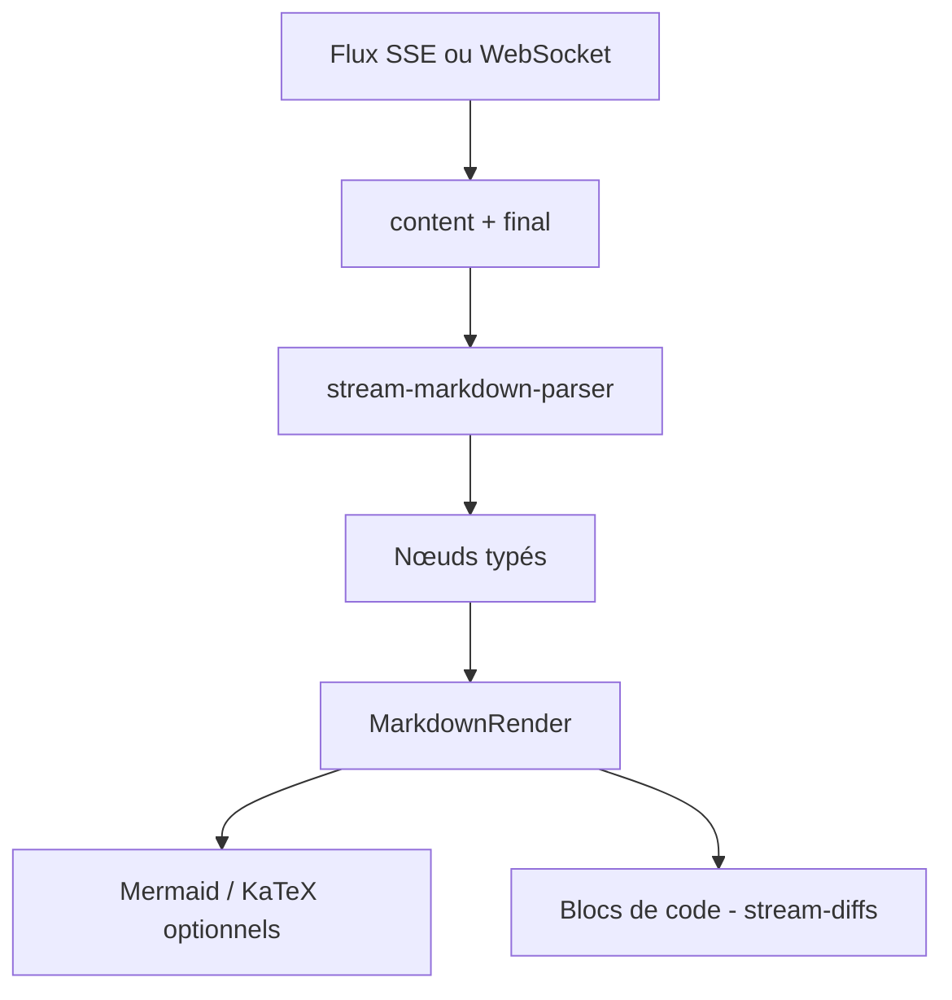

# Simon-He95/markstream-vue

> Family of streaming Markdown renderers for AI chat interfaces, in Vue, React, Svelte, Angular and others.

## The problem
When an LLM sends Markdown token by token, classic renderers flicker, leave code blocks or formulas unclosed, and degrade on long answers.

## What it actually does
The `MarkdownRender` component displays still-incomplete Markdown stably. Two modes: virtual window for long documents, incremental batches for the typewriter effect. Mermaid, KaTeX and rich code blocks (via `stream-diffs`) are optional. You can also provide nodes pre-parsed on the server side. One package exists per framework, plus a standalone parser.

## How it is wired
Simplified diagram based on the fiche, no diagram provided.



## Trying it
```bash
pnpm add markstream-vue
```
```vue
<script setup>
import MarkdownRender from 'markstream-vue'
import 'markstream-vue/index.css'
</script>
<template>
  <MarkdownRender :content="content" />
</template>
```

## Cost and gotchas
Free. For untrusted user content, the README recommends `htmlPolicy="escape"`. Version 2 removes the old Monaco code runners: plan a migration from 1.x.

## What it is not
It is not a parser for finished documents: for static Markdown, the README points to marked, markdown-it or react-markdown. The README was truncated before the end; the announced benchmarks are not verified here.

## Alternatives
- marked / markdown-it: for finished documents.
- react-markdown: same case, React side.
- Streamdown: comparison cited in the README.

## For you
Worth watching: relevant if you are building a Vue or React chat interface around an LLM, otherwise irrelevant for a pure data profile; a single maintainer behind seven packages.
