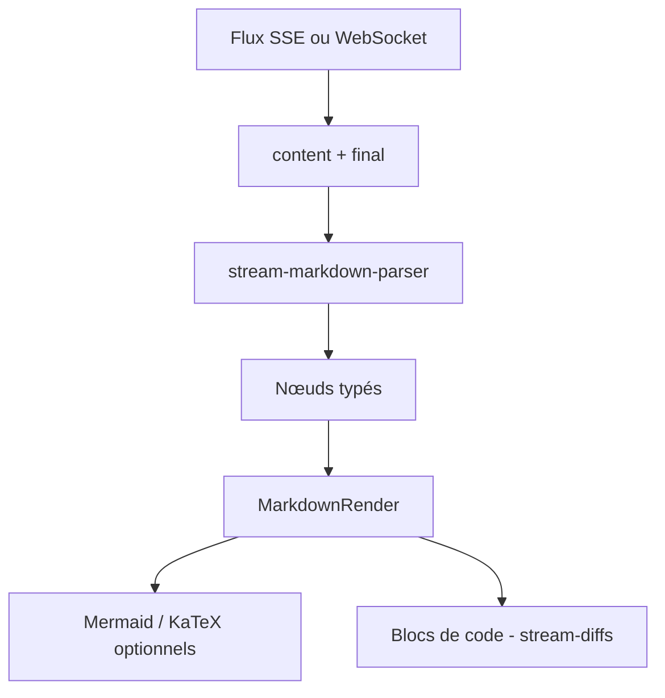

# Simon-He95/markstream-vue

> Famille de rendus Markdown en streaming pour interfaces de chat IA, en Vue, React, Svelte, Angular et autres.

## Le problème
Quand un LLM envoie du Markdown token par token, les rendus classiques scintillent, laissent des blocs de code ou des formules non fermés et se dégradent sur les longues réponses.

## Ce que ça fait vraiment
Le composant `MarkdownRender` affiche un Markdown encore incomplet de façon stable. Deux modes : fenêtre virtuelle pour les longs documents, lots incrémentaux pour l'effet machine à écrire. Mermaid, KaTeX et les blocs de code enrichis (via `stream-diffs`) sont optionnels. On peut aussi fournir des nœuds pré-analysés côté serveur. Un paquet existe par framework, plus un analyseur indépendant.

## Comment c'est branché
Schéma simplifié d'après la fiche, sans diagramme fourni.



## Essayer
```bash
pnpm add markstream-vue
```
```vue
<script setup>
import MarkdownRender from 'markstream-vue'
import 'markstream-vue/index.css'
</script>
<template>
  <MarkdownRender :content="content" />
</template>
```

## Coût et pièges
Gratuit. Pour du contenu utilisateur non fiable, le README recommande `htmlPolicy="escape"`. La version 2 retire les anciens exécutants de code Monaco : migration à prévoir depuis la 1.x.

## Ce que ce n'est pas
Ce n'est pas un parseur de documents finis : pour du Markdown figé, le README renvoie vers marked, markdown-it ou react-markdown. Le README a été tronqué avant la fin ; les benchmarks annoncés ne sont pas vérifiés ici.

## Alternatives
- marked / markdown-it : pour des documents terminés.
- react-markdown : même cas, côté React.
- Streamdown : comparaison citée dans le README.

## Pour toi
À surveiller : pertinent si tu bâtis une interface de chat Vue ou React autour d'un LLM, sinon sans objet pour un profil data pur ; un seul mainteneur derrière sept paquets.

