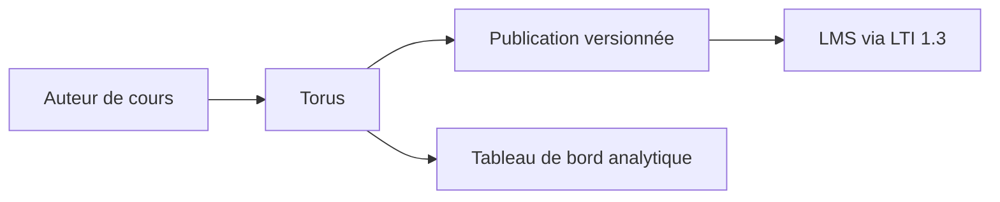

# Simon-Initiative/oli-torus

> Course authoring and delivery platform (Open Learning Initiative), LTI 1.3 compatible.

## The problem
Designing online courses whose usage data guides continuous improvement.

## What it actually does
Integrated authoring and delivery (rich text, media, interactive activities), analytics dashboard, course publishing and versioning, extensible third-party activity framework, LTI 1.3. A managed instance exists or you self-host. Installation is on the wiki, not provided.

## How it is wired

## Trying it
No command in the README: see the wiki.

## Cost and gotchas
Free when self-hosted; managed instance separate. Technical stack not described.

## What it is not
Not an LMS: it plugs into a compatible LMS.

## Alternatives
No alternative named in the README.

## For you
Ignore: an e-learning platform with no direct link to data/AI/MLOps.
