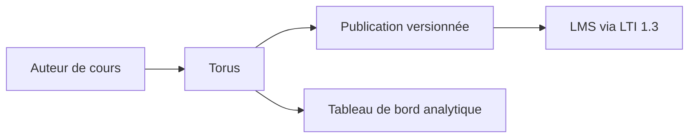

# Simon-Initiative/oli-torus

> Plateforme de création et de diffusion de cours (Open Learning Initiative), compatible LTI 1.3.

## Le problème
Concevoir des cours en ligne dont les données d'usage guident l'amélioration continue.

## Ce que ça fait vraiment
Création et diffusion intégrées (texte riche, médias, activités interactives), tableau de bord d'analyse, publication et versionnage des cours, cadre d'activités tierces extensible, LTI 1.3. Une instance gérée existe ou on héberge soi-même. L'installation est sur le wiki, non fournie.

## Comment c'est branché

## Essayer
Aucune commande dans le README : voir le wiki.

## Coût et pièges
Gratuit en auto-hébergé ; instance gérée à part. Pile technique non décrite.

## Ce que ce n'est pas
Pas un LMS : il se branche sur un LMS compatible.

## Alternatives
Aucune alternative nommée dans le README.

## Pour toi
À ignorer : plateforme e-learning sans lien direct avec data/IA/MLOps.

