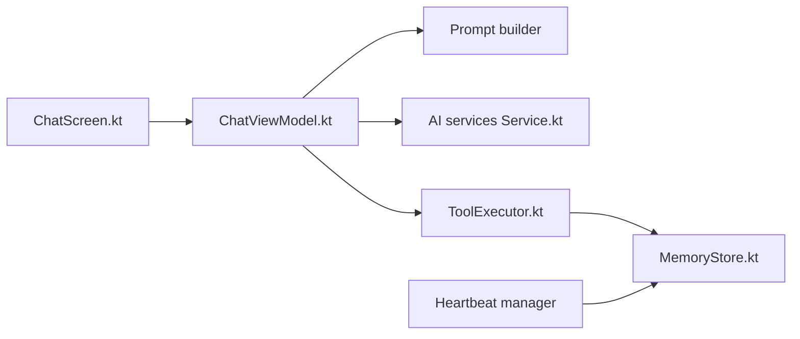

# SimonSchubert/Kai

> Open source cross-platform AI assistant with persistent memory, tools and MCP servers.

## The problem
AI assistants forget from one conversation to the next and remain tied to a single provider.

## What it actually does
Chat loop: prompt plus memories, call to an LLM (30 providers with automatic fallback), tool execution (web search, notifications, calendar, shell, MCP), memory promoted into the system prompt after 5 uses, and a "heartbeat" every 30 minutes that only notifies when needed. Local inference on Android (LiteRT), Alpine sandbox via proot, generated interface, encrypted storage.

## How it is wired


## Trying it
```bash
brew install --cask simonschubert/tap/kai
yay -S kai-bin
winget install SimonSchubert.Kai
```

## Cost and gotchas
Free, but LLM calls go through the API keys you configure. The listed MCP servers are free, with an optional key for Jina AI.

## What it is not
Not an agent framework: it is a finished application. The automatic Splinterlands game is a separate integration and unrelated to the main use.

## Alternatives
No alternative named in the README.

## For you
Worth watching: a concrete reference for persistent memory and MCP in a consumer app, probably to be read rather than adopted, given the single maintainer.
