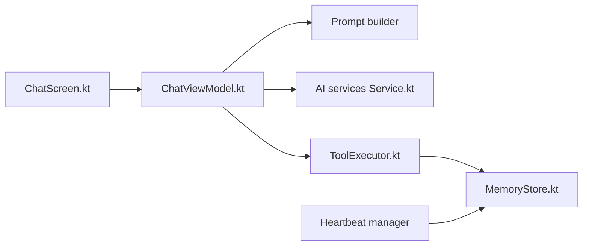

# SimonSchubert/Kai

> Assistant IA open source multiplateforme avec mémoire persistante, outils et serveurs MCP.

## Le problème
Les assistants IA oublient d'une conversation à l'autre et restent liés à un seul fournisseur.

## Ce que ça fait vraiment
Boucle de chat : prompt plus mémoires, appel d'un LLM (30 fournisseurs avec bascule automatique), exécution d'outils (recherche web, notifications, agenda, shell, MCP), mémoire promue dans le prompt système après 5 usages, et « heartbeat » toutes les 30 minutes qui ne notifie qu'en cas de besoin. Inférence locale sur Android (LiteRT), sandbox Alpine via proot, interface générée, stockage chiffré.

## Comment c'est branché


## Essayer
```bash
brew install --cask simonschubert/tap/kai
yay -S kai-bin
winget install SimonSchubert.Kai
```

## Coût et pièges
Gratuit, mais les appels LLM passent par les clés d'API que tu configures. Les serveurs MCP listés sont gratuits, avec clé optionnelle pour Jina AI.

## Ce que ce n'est pas
Pas un framework d'agents : c'est une application finale. Le jeu automatique Splinterlands est une intégration à part et sans lien avec l'usage principal.

## Alternatives
Aucune alternative nommée dans le README.

## Pour toi
À surveiller : référence concrète de mémoire persistante et de MCP dans une app grand public, sans doute à lire plus qu'à adopter, vu le mainteneur unique.

