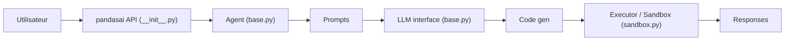

# Sinaptik-AI/pandas-ai

> Python library that translates natural-language questions into code executed on dataframes.

## The problem
Querying a dataset requires writing pandas or SQL. Non-technical profiles are shut out, and the others waste time on routine queries.

## What it actually does
`df.chat("…")` sends the schema and the question to an LLM (via `pandasai-litellm`), which generates code or SQL.
The `core/code_generation` subsystem cleans and validates that code before execution, locally or in a Docker sandbox (`pandasai-docker`).
The result is typed: dataframe, number, text, chart or error. Several dataframes can be queried together.
Separate extensions add SQL, BigQuery, Snowflake and vector database connectors; an `ee` part is under an enterprise license.

## How it is wired


## Trying it
```bash
pip install pandasai
pip install pandasai-litellm
pip install "pandasai-docker"
```

## Cost and gotchas
Each question consumes tokens at your LLM provider (OpenAI key in the examples). Python limited to 3.8–3.11; the Docker sandbox is optional but recommended.

## What it is not
Not a risk-free tool: without the sandbox, LLM-generated code runs on your machine. Not entirely open source: the `ee` folder belongs to an enterprise offering. The helpers module includes telemetry (architecture).

## Alternatives
No alternative named in the README.

## For you
Worth watching: useful for prototyping conversational analysis, but the unidentified license and the enterprise part need clarifying before any client use.
