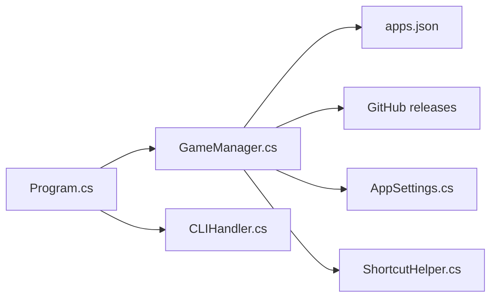

# SirDiabo/GithubLauncher

> .NET desktop launcher that downloads, updates and starts applications published as GitHub releases.

## The problem
Manually installing and updating applications distributed only through GitHub releases is tedious.

## What it actually does
Reads an `apps.json` file (name, repository, folder, icon), queries the GitHub releases, downloads and unpacks the application, launches it, uninstalls it, and updates itself. Avalonia interface with gamepad navigation, CLI commands, desktop and Steam shortcuts.

## How it is wired


## Trying it
```text
1. Download the latest release from the Releases page
2. Extract the downloaded archive to your preferred location
3. Run the executable.
```

## Cost and gotchas
Free; .NET 9 runtime required. A personal GitHub token is recommended to avoid rate limits: never share it.

## What it is not
Formerly "N64Recomp Launcher", renamed: manual migration from the old version. Not a secure package manager: it launches third-party executables.

## Alternatives
No alternative named (an N64-oriented version is mentioned).

## For you
Ignore: a desktop tool for games and third-party applications, outside the data/AI scope.
