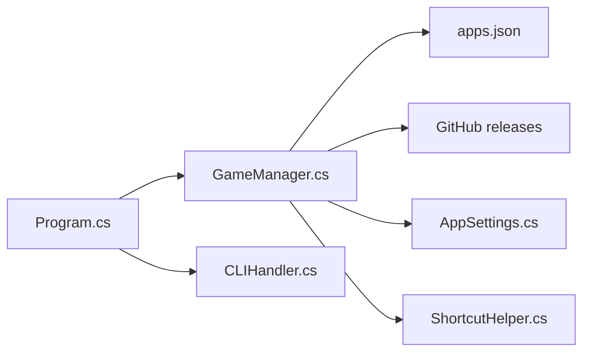

# SirDiabo/GithubLauncher

> Lanceur de bureau en .NET qui télécharge, met à jour et démarre des applications publiées en releases GitHub.

## Le problème
Installer et mettre à jour à la main des applications distribuées uniquement via des releases GitHub est fastidieux.

## Ce que ça fait vraiment
Lit un fichier `apps.json` (nom, dépôt, dossier, icône), interroge les releases GitHub, télécharge et décompresse l'application, la lance, la désinstalle, et se met à jour lui-même. Interface Avalonia avec navigation manette, commandes CLI, raccourcis bureau et Steam.

## Comment c'est branché


## Essayer
```text
1. Download the latest release from the Releases page
2. Extract the downloaded archive to your preferred location
3. Run the executable.
```

## Coût et pièges
Gratuit ; runtime .NET 9 requis. Un jeton GitHub personnel est conseillé pour éviter les limites de débit : à ne jamais partager.

## Ce que ce n'est pas
Ancien « N64Recomp Launcher » renommé : migration manuelle de l'ancienne version. Ce n'est pas un gestionnaire de paquets sécurisé : il lance des exécutables tiers.

## Alternatives
Aucune alternative nommée (une version orientée N64 est mentionnée).

## Pour toi
Ignorer : outil de bureau pour jeux et applications tierces, hors périmètre data/IA.

