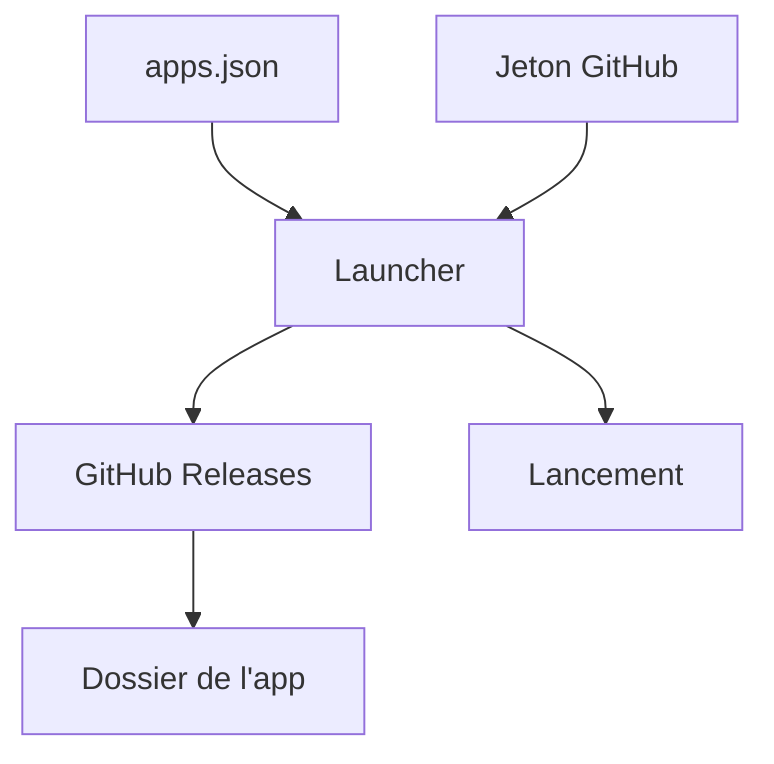

# SirDiabo/N64RecompLauncher

> Desktop launcher that downloads, updates and runs applications hosted on GitHub.

## The problem
Manually fetching and updating applications published in GitHub releases is tedious.

## What it actually does
It reads an `apps.json` file (name, repository, folder, icon), checks the GitHub releases, downloads and launches the chosen application. An optional GitHub token avoids rate limits. Formerly a launcher dedicated to N64Recomp games.

## How it is wired
Simplified diagram based on the sheet, no diagram provided.



## Trying it
No command: download a release, extract it and run the executable (.NET 9 required).
```bash
# non documenté : exécuter le binaire extrait
```

## Cost and gotchas
Free; .NET 9 runtime and Internet access. The rename from N64RecompLauncher requires a manual update for older versions.

## What it is not
Not a data or AI tool. It does not contain the applications, it fetches them.

## Alternatives
No alternative named in the README.

## For you
Ignore: game launcher unrelated to your data/AI/MLOps work.
