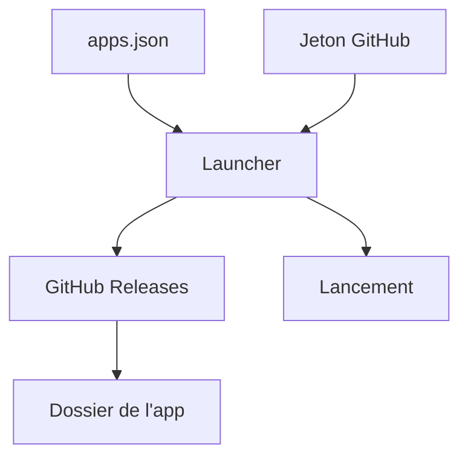

# SirDiabo/N64RecompLauncher

> Lanceur de bureau qui télécharge, met à jour et lance des applications hébergées sur GitHub.

## Le problème
Récupérer et mettre à jour à la main des applications publiées dans des releases GitHub est fastidieux.

## Ce que ça fait vraiment
Il lit un fichier `apps.json` (nom, dépôt, dossier, icône), vérifie les releases GitHub, télécharge et lance l'application choisie. Un jeton GitHub optionnel évite les limites de débit. Ex-lanceur dédié aux jeux N64Recomp.

## Comment c'est branché
Schéma simplifié d'après la fiche, sans diagramme fourni.



## Essayer
Aucune commande : télécharger une release, extraire et lancer l'exécutable (.NET 9 requis).
```bash
# non documenté : exécuter le binaire extrait
```

## Coût et pièges
Gratuit ; Runtime .NET 9 et accès Internet. Le renommage depuis N64RecompLauncher impose une mise à jour manuelle pour les anciennes versions.

## Ce que ce n'est pas
Pas un outil data ou IA. Il ne contient pas les applications, il les récupère.

## Alternatives
Aucune alternative nommée dans le README.

## Pour toi
À ignorer : lanceur de jeux sans rapport avec ton métier data/IA/MLOps.

