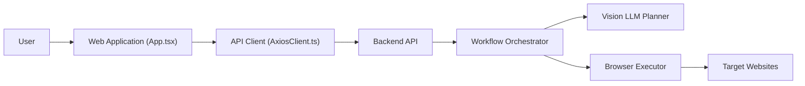

# Skyvern-AI/skyvern

> Browser automation driven by LLM and vision, a Playwright extension plus a workflow editor.

## The problem
Web automation scripts rely on XPaths that break at the slightest layout change, and every site needs its own script.

## What it actually does
Adds `act`, `extract` (with JSON schema), `validate`, `prompt` to the Playwright page, and a fallback mode: CSS selector first, AI afterwards.
`page.agent.run_task` chains multi-step tasks; workflows combine navigation, extraction, loops, emails, HTTP blocks and code.
Local server + UI (SQLite by default, Postgres possible), browser livestream, Bitwarden integration, MCP, Zapier/Make/N8N.
Can drive your own Chrome via CDP.

## How it is wired


## Trying it
```bash
pip install "skyvern[all]"
skyvern quickstart
skyvern run all
docker compose up -d
```

## Cost and gotchas
You must supply an LLM key in `.env`; each action consumes vision calls. Skyvern Cloud is paid, with anti-bot and CAPTCHA handling that the local version lacks.

## What it is not
Not deterministic like a pure Playwright script. AGPL-3.0. Telemetry is enabled by default (can be disabled via `SKYVERN_TELEMETRY=false`).

## Alternatives
No alternative named in the README.

## For you
Worth watching: handy for data collection on sites without an API, but the LLM cost per page and the AGPL limit large-scale or product use.
