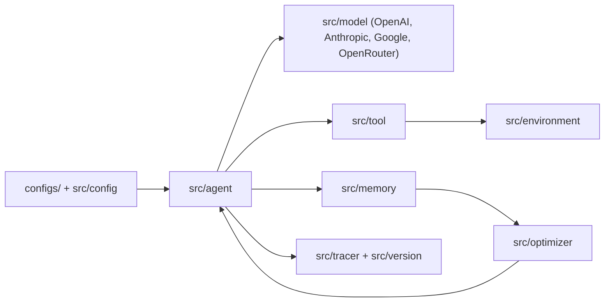

# SkyworkAI/DeepResearchAgent

> Python runtime for LLM agents whose prompts, tools and memory evolve, aimed at agent researchers.

## The problem
Agent protocols handle the lifecycle, versioning and safe updating of their components poorly. You end up with fragile glue code.

## What it actually does
Prompts, agents, tools, environments and memory are versioned resources, assembled by MMEngine-style configs. An Act → Observe → Optimize → Remember loop relies on optimizers (reflection, GRPO, Reinforce++). The repository also ships browsing, trading and ESG agents, plus a vendored LightRAG.

## How it is wired


## Trying it
```bash
python examples/run_tool_calling_agent.py --config configs/tool_calling_agent.py
python examples/run_tool_calling_agent.py \
  --config configs/tool_calling_agent.py \
  --cfg-options model_name=openrouter/gpt-4o workdir=workdir/demo tag=demo
```
README prerequisites: install the dependencies, copy `.env.template` to `.env` and put a key in it (e.g. `OPENROUTER_API_KEY`).

## Cost and gotchas
Model API key at your expense. The repository is very broad (trading, ESG, vendored LightRAG): the surface to understand is large.

## What it is not
Not a ready-to-use "deep research" product: it is an experimentation framework. The trading or mobile modules have no documented guarantee. The README gives no benchmarks.

## Alternatives
No alternative named in the README.

## For you
Worth watching if you study agent self-improvement (optimizers, traces, versioning): the idea is solid, but maturity is not documented.
