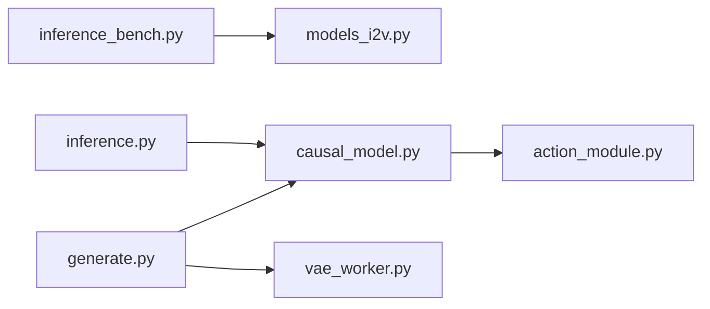

# SkyworkAI/Matrix-Game

> Family of interactive world models from Skywork AI that generate video driven by commands.

## The problem
Not documented in the README, which is too short to establish it.

## What it actually does
The README announces three generations (1.0, 2.0, 3.0) of official world-model implementations. Judging from the architecture: Matrix-Game 1 does image-to-video with a diffusion transformer; 2 adds causal and flow generation, with action conditioning; 3 adds asynchronous VAE decoding and sequence parallelism; a WorldScore evaluation is included.

## How it is wired


## Trying it
```bash
# Aucune commande documentée dans le README.
```

## Cost and gotchas
Not documented; these are video diffusion models, so a GPU is expected, which the README does not specify.

## What it is not
Not documented: the README has neither installation nor example, so there is no way to know how to use it.

## Alternatives
No alternative named in the README.

## For you
Keep an eye on it: an active research topic (world models), but not enough material to decide: read the subfolders before investing time.
