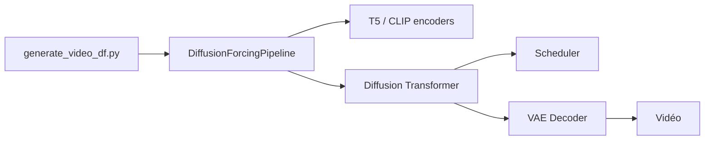

# SkyworkAI/SkyReels-V2

> Unlimited-length video generation models using Diffusion Forcing, with inference code.

## The problem
Open video models mostly produce 5 to 10 second clips.

## What it actually does
1.3B and 14B weights (540P/720P) for text-to-video, image-to-video and Diffusion Forcing (video extension, start/end control). Single- or multi-GPU inference (xDiT USP), `diffusers` integration, Qwen2.5-32B prompt enhancer, SkyCaptioner-V1 captioner. The comparative scores are the authors' own.

## How it is wired


## Trying it
```bash
git clone https://github.com/SkyworkAI/SkyReels-V2
cd SkyReels-V2
pip install -r requirements.txt
python3 generate_video_df.py --model_id Skywork/SkyReels-V2-DF-14B-540P --resolution 540P --ar_step 0 --base_num_frames 97 --num_frames 257 --overlap_history 17 --prompt "..." --addnoise_condition 20 --offload
```

## Cost and gotchas
GPU: about 14.7 GB of VRAM for the 1.3B, 51 GB for the 14B at 540P; 64 GB+ with the prompt enhancer. License not identified by GitHub. 5B checkpoints "coming soon".

## What it is not
Not a turnkey product: generation is slow, especially in asynchronous mode.

## Alternatives
Wan2.1-14B and HunyuanVideo-13B, compared in the README.

## For you
Watch: interesting for generative video if you have a powerful GPU; license to be checked.
