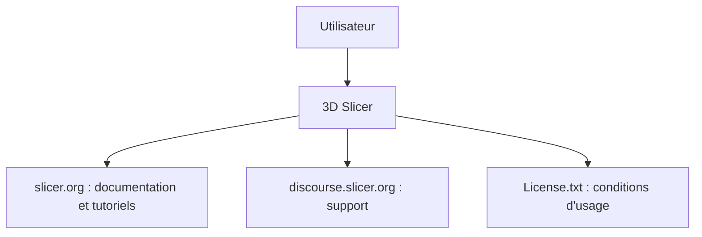

# Slicer/Slicer

> Free, cross-platform software for image visualization and analysis, for imaging research.

## The problem
Visualizing and analyzing images (medical, judging by the tool's name) requires software that is often closed or expensive. The README gives no further detail.

## What it actually does
The very short README announces free software for image visualization and analysis, available on Windows, Linux and macOS. The specific functions are not documented in the material provided: everything goes through slicer.org and the Discourse forum. Refers to License.txt for usage.

## How it is wired
Simplified diagram based on the sheet, no diagram provided.

## Trying it
No command documented in the README. See https://www.slicer.org for the download and tutorials.

## Cost and gotchas
Free. License present but not identified by GitHub: read License.txt before any commercial use. 667 open issues.

## What it is not
Not a Python library to install with pip according to the README. Nothing is said about the analysis functions or about medical regulatory maturity: not documented here.

## Alternatives
No alternative named in the README.

## For you
Worth watching: the material is too thin to judge, and the license needs reading; useful only if you work with imaging.
