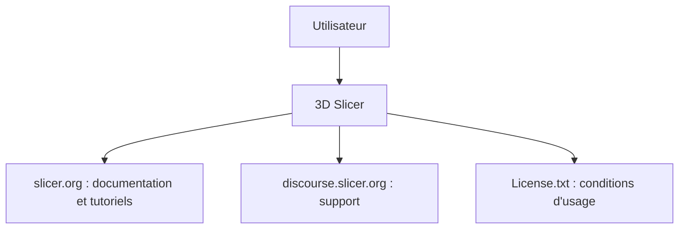

# Slicer/Slicer

> Logiciel libre de visualisation et d'analyse d'images, multiplateforme, pour la recherche en imagerie.

## Le problème
Visualiser et analyser des images (médicales, d'après le nom de l'outil) demande des logiciels souvent fermés ou coûteux. Le README ne détaille pas davantage.

## Ce que ça fait vraiment
Le README, très court, annonce un logiciel libre de visualisation et d'analyse d'image, disponible sous Windows, Linux et macOS. Les fonctions précises ne sont pas documentées dans la matière fournie : tout passe par slicer.org et le forum Discourse. Renvoie à License.txt pour l'usage.

## Comment c'est branché
Schéma simplifié d'après la fiche, sans diagramme fourni.

## Essayer
Aucune commande documentée dans le README. Voir https://www.slicer.org pour le téléchargement et les tutoriels.

## Coût et pièges
Gratuit. Licence présente mais non identifiée par GitHub : lire License.txt avant tout usage commercial. 667 issues ouvertes.

## Ce que ce n'est pas
Pas une bibliothèque Python à installer par pip d'après le README. Rien n'est dit sur les fonctions d'analyse ni sur la maturité réglementaire médicale : non documenté ici.

## Alternatives
Aucune alternative nommée dans le README.

## Pour toi
À surveiller : la matière est trop mince pour juger, et la licence est à lire ; utile seulement si tu touches à l'imagerie.

