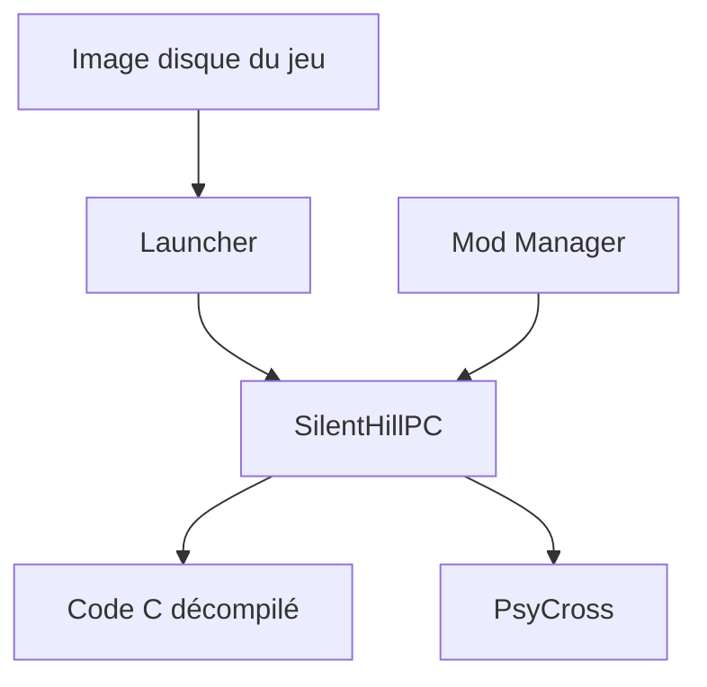

# SlickAmogus/silent-hill-decomp

> Native PC port of the first Silent Hill, built on its PSX decompilation, for players and modders.

## The problem
The 1999 PlayStation game runs poorly or not at all on a modern machine without an emulator.

## What it actually does
Windows and Linux executable compiled from the decompiled C, neither an emulator nor static recompilation. It adds widescreen resolutions, alternative cameras, a modern flashlight, a Mod Manager, a cheat console, RetroAchievements and translations. It uses PsyCross as the hardware layer. Development is announced as heavily AI-assisted.

## How it is wired
Simplified diagram based on the sheet, no diagram provided.


## Trying it
```bash
git submodule update --init --recursive
cd silent-hill-decomp/pc_port
cmake -S . -B build -G Ninja -DSH_BUILD_MAP_DLLS=ON
cmake --build build
```

## Cost and gotchas
You must own a legal disc image of the game: no data is provided. Linux and macOS are under development, Wine is recommended. The build is not signed. The GPL-3.0 license covers only the port, not the decompilation.

## What it is not
It is not a standalone game nor an emulator. It contains no Konami assets.

## Alternatives
Not documented in the README.

## For you
Ignore for a data / AI / MLOps profile: it is a retro game project unrelated to your work, even if the AI-assisted decompilation approach is curious.
