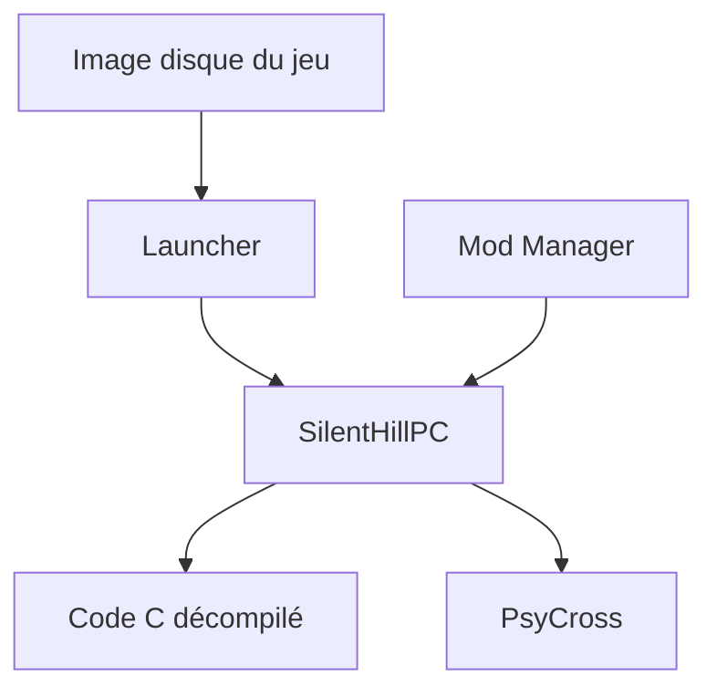

# SlickAmogus/silent-hill-decomp

> Portage PC natif du premier Silent Hill, bâti sur sa décompilation PSX, pour joueurs et moddeurs.

## Le problème
Le jeu PlayStation de 1999 tourne mal ou pas sur machine moderne sans émulateur.

## Ce que ça fait vraiment
Exécutable Windows et Linux compilé depuis le C décompilé, ni émulateur ni recompilation statique. Il ajoute résolutions larges, caméras alternatives, lampe torche moderne, Mod Manager, console de triche, RetroAchievements et traductions. Il utilise PsyCross comme couche matérielle. Le développement est annoncé comme fortement assisté par IA.

## Comment c'est branché
Schéma simplifié d'après la fiche, sans diagramme fourni.


## Essayer
```bash
git submodule update --init --recursive
cd silent-hill-decomp/pc_port
cmake -S . -B build -G Ninja -DSH_BUILD_MAP_DLLS=ON
cmake --build build
```

## Coût et pièges
Il faut posséder une image disque légale du jeu : aucune donnée n'est fournie. Linux et macOS sont en cours de développement, Wine est recommandé. Le build n'est pas signé. La licence GPL-3.0 ne couvre que le port, pas la décompilation.

## Ce que ce n'est pas
Ce n'est pas un jeu autonome ni un émulateur. Il ne contient aucun actif de Konami.

## Alternatives
Non documenté dans le README.

## Pour toi
À ignorer pour un profil data / IA / MLOps : c'est un projet de jeu rétro sans lien avec ton métier, même si l'approche de décompilation assistée par IA est curieuse.

