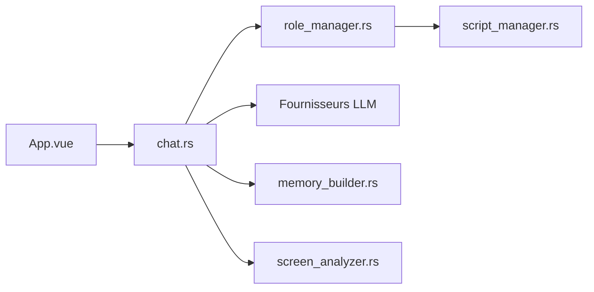

# SlimeBoyOwO/LingChat

> AI desktop companion with characters, voice and memory, for fans of narrative games.

## The problem
Chat assistants are impersonal; here you want a persistent character with emotions, memory and a presence on the desktop.

## What it actually does
A Windows desktop chat application with customizable characters, per-save memory, emotion recognition, voice via VITS, screen vision (proactive monitoring), desktop pet mode, multi-character scripts, pomodoro, agenda and tasks. The language model is added through an API key (DeepSeek or other) in the settings.

## How it is wired

## Trying it
No documented command: download the `LingChat vX.X.X.7z` archive from the Releases, run `LingChat.exe`, then enter the API key in the advanced settings.

## Cost and gotchas
API key at your expense (credit required on the chosen platform). Vision requires a vision model. Windows may delete the executable by mistake (Defender). Voice is slow on integrated GPUs.

## What it is not
Not a serious productivity tool: an entertainment application. The assets (Blue Archive, Undertale) and the default artwork must not be used commercially. AGPL-3.0 license. README in Chinese.

## Alternatives
No alternative named in the README (Zcchat is cited as a source of inspiration).

## For you
Ignore: a consumer application unrelated to data/AI/MLOps, with assets limited to non-commercial use.
