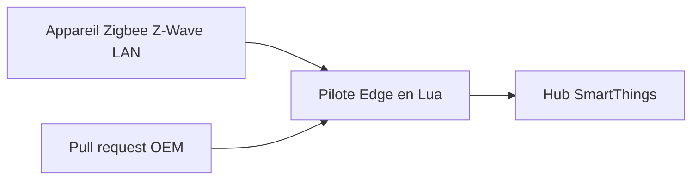

# SmartThingsCommunity/SmartThingsEdgeDrivers

> Lua drivers for Zigbee, Z-Wave and LAN connected devices, running locally on SmartThings hubs.

## The problem
Connected devices must be controlled by the hub without depending on the cloud.

## What it actually does
Repository of Edge drivers in Lua for SmartThings hubs. It is mainly for manufacturers (OEMs) who submit pull requests for Works With SmartThings certification, certification maintenance and bug fixes. Contributors sign an individual license agreement.

## How it is wired
Simplified diagram based on the fiche, no diagram provided.


## Trying it
```bash
# Aucune commande dans le README.
# Il renvoie vers le portail de documentation développeur SmartThings.
```

## Cost and gotchas
A SmartThings hub and an account are needed to deploy a driver. Contributions go through a contributor license agreement. The README is very short.

## What it is not
Not a tool to install on its own: it only works on SmartThings hubs. Not a generic open home automation platform.

## Alternatives
No alternative named in the README.

## For you
Ignore: vendor-specific home automation, unrelated to your data, AI or MLOps work.
