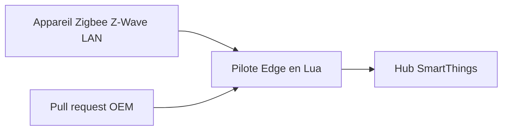

# SmartThingsCommunity/SmartThingsEdgeDrivers

> Pilotes Lua pour objets connectés Zigbee, Z-Wave et LAN, exécutés en local sur les hubs SmartThings.

## Le problème
Les appareils connectés doivent être pilotés par le hub sans dépendre du cloud.

## Ce que ça fait vraiment
Dépôt de pilotes Edge en Lua pour les hubs SmartThings. Il sert surtout aux fabricants (OEM) qui soumettent des pull requests pour la certification Works With SmartThings, la maintenance de la certification et des corrections de bugs. Les contributeurs signent un accord de licence individuel.

## Comment c'est branché
Schéma simplifié d'après la fiche, sans diagramme fourni.


## Essayer
```bash
# Aucune commande dans le README.
# Il renvoie vers le portail de documentation développeur SmartThings.
```

## Coût et pièges
Il faut un hub SmartThings et un compte pour déployer un pilote. Les contributions passent par un accord de licence de contributeur. Le README est très court.

## Ce que ce n'est pas
Pas un outil à installer seul : il ne fonctionne que sur les hubs SmartThings. Pas une plateforme domotique ouverte générique.

## Alternatives
Aucune alternative nommée dans le README.

## Pour toi
À ignorer : domotique propre à un fabricant, sans lien avec ton travail data, IA ou MLOps.

