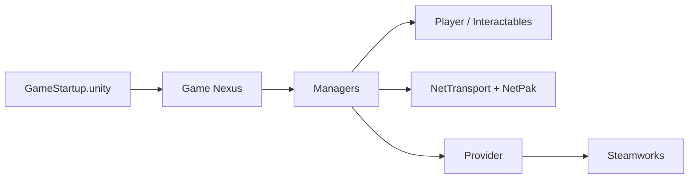

# SmartlyDressedGames/U3-SDK

> Source code of Unturned, a free zombie survival game, for modders and Unity developers.

## The problem
Modding a closed game forces you to decompile; here the game's code is open so you can build extensions.

## What it actually does
Unity 2022.3 project with the `GameStartup.unity` startup scene, managers for the world, players, zombies and vehicles, a custom network stack (NetTransport, NetPak, NetInvokable), an abstraction of Steam services (Provider), IMGUI, uGUI and UI Toolkit interfaces, and editor tooling (NetGen, SteamCMD).

## How it is wired

## Trying it
No command: manual procedure (Unity Hub, editor 2022.3.62f3, open `Assets/GameStartup.unity`, Play). Steam and Unturned must be installed.

## Cost and gotchas
Free. Requires Steam running and the game installed (binaries and mods are read from there). License "present but not identified": read the file before any reuse.

## What it is not
Not a reusable game engine. Not a data tool. No clear license for reusing the code.

## Alternatives
No alternative named in the README.

## For you
Ignore: unrelated to data/AI; interest limited to reading a Unity game network architecture.
