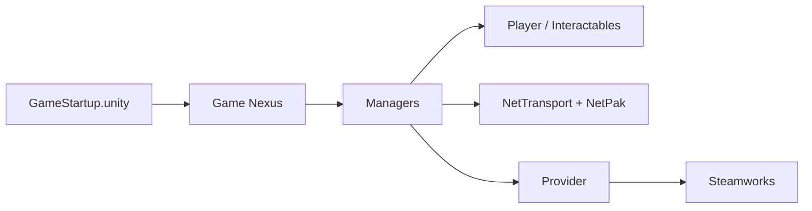

# SmartlyDressedGames/U3-SDK

> Code source d'Unturned, jeu de survie zombie gratuit, pour moddeurs et développeurs Unity.

## Le problème
Modder un jeu fermé oblige à décompiler ; ici le code du jeu est ouvert pour créer des extensions.

## Ce que ça fait vraiment
Projet Unity 2022.3 avec la scène de démarrage `GameStartup.unity`, des gestionnaires de monde, joueurs, zombies et véhicules, une pile réseau maison (NetTransport, NetPak, NetInvokable), une abstraction des services Steam (Provider), des interfaces IMGUI, uGUI et UI Toolkit, et un outillage éditeur (NetGen, SteamCMD).

## Comment c'est branché

## Essayer
Aucune commande : procédure manuelle (Unity Hub, éditeur 2022.3.62f3, ouvrir `Assets/GameStartup.unity`, Play). Steam et Unturned doivent être installés.

## Coût et pièges
Gratuit. Exige Steam lancé et le jeu installé (binaires et mods lus depuis là). Licence « présente mais non identifiée » : lire le fichier avant toute réutilisation.

## Ce que ce n'est pas
Pas un moteur de jeu réutilisable. Pas un outil data. Pas de licence claire pour reprendre le code.

## Alternatives
Aucune alternative nommée dans le README.

## Pour toi
Ignorer : sans rapport avec data/IA ; intérêt limité à la lecture d'une architecture réseau de jeu Unity.

