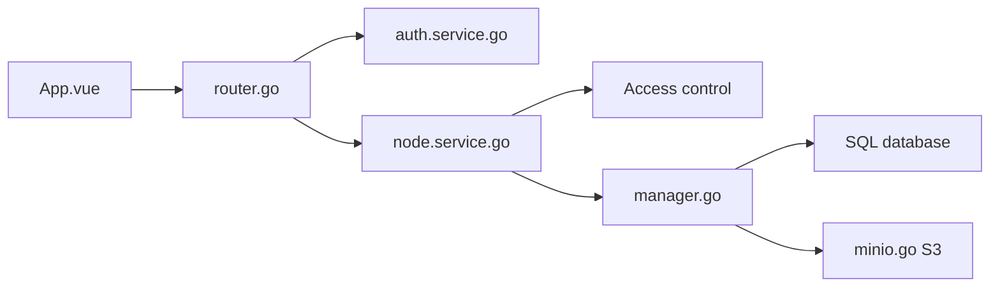

# Smaug6739/Alexandrie

> Self-hosted knowledge base with an extended Markdown editor, for teams and individuals.

## The problem
Wikis on the market are hosted by a third party or heavy to deploy if you want to keep your notes at home.

## What it actually does
CodeMirror 6 editor (LaTeX, diagrams, snippets, dictation), team spaces with five access levels, full-text search, Kanban, offline PWA, OIDC SSO, S3-compatible storage, ZIP import/export. Vue frontend, Go API, SQL database.

## How it is wired


## Trying it
```bash
curl -O https://raw.githubusercontent.com/Smaug6739/Alexandrie/main/.env.example
curl -O https://raw.githubusercontent.com/Smaug6739/Alexandrie/main/docker-compose.yml
cp .env.example .env
docker compose up -d
```

## Cost and gotchas
Docker and S3-compatible storage. The README claims to be "production ready"; that is the author's word, nothing here proves it.

## What it is not
Not a proven replica of Notion or Confluence: the README presents it as an alternative, without a comparison.

## Alternatives
- Notion, Confluence, Obsidian: cited as market references.

## For you
Worth watching: a local Markdown wiki can hold your technical notes, but a single maintainer is a reason to keep your exports.
