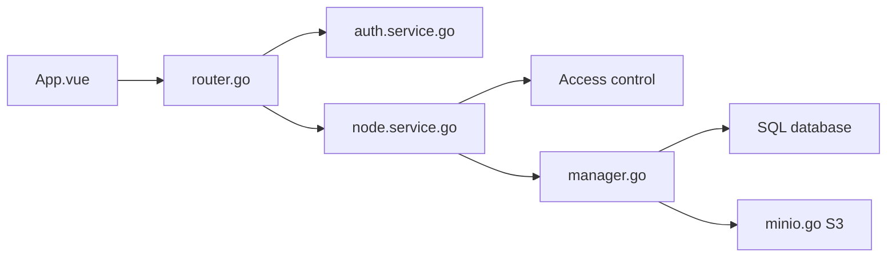

# Smaug6739/Alexandrie

> Base de connaissances auto-hébergée avec éditeur Markdown étendu, pour équipes et particuliers.

## Le problème
Les wikis du marché sont hébergés chez un tiers ou lourds à déployer pour garder ses notes chez soi.

## Ce que ça fait vraiment
Éditeur CodeMirror 6 (LaTeX, diagrammes, snippets, dictée), espaces d'équipe avec cinq niveaux d'accès, recherche plein texte, Kanban, PWA hors ligne, SSO OIDC, stockage compatible S3, import/export ZIP. Frontend Vue, API Go, base SQL.

## Comment c'est branché


## Essayer
```bash
curl -O https://raw.githubusercontent.com/Smaug6739/Alexandrie/main/.env.example
curl -O https://raw.githubusercontent.com/Smaug6739/Alexandrie/main/docker-compose.yml
cp .env.example .env
docker compose up -d
```

## Coût et pièges
Docker et un stockage S3 compatible. Le README s'annonce « prêt pour la production » ; c'est l'auteur qui le dit, rien ne le prouve ici.

## Ce que ce n'est pas
Pas une réplique avérée de Notion ou Confluence : le README la présente comme une alternative, sans comparatif.

## Alternatives
- Notion, Confluence, Obsidian : cités comme références du marché.

## Pour toi
À surveiller : un wiki Markdown local peut servir tes notes techniques, mais un mainteneur unique incite à garder tes exports.

